# RT Zerosum — 전투 + 기지(아웃게임) 플레이어블 프로토타입 (Godot 4.7)

횡스크롤 턴제 6인 AP 전투 프로토타입. `docs/design/PROTOTYPE_GDD_v1_0.md` 의 확정 규칙과 임시값을 구현했고,
**같은 전투 규칙 위에 2D 표현(원화 + 구역 마스크 셰이더)과 3D 표현(셀 셰이더 + 실광원) 두 가지 뷰**를 올려
그래픽 방향(2D vs 3D)을 비교·결정할 수 있게 했습니다. 비교 결과는 `docs/2D_vs_3D_comparison.md` 참조.

## 설치 (노트북·데스크톱 공통, 명령 한 줄)
각 기기의 `/Users/eunjikim/Game/zerosum` (= `~/Game/zerosum`, Windows 는 `C:\Users\<이름>\Game\zerosum`)에 프로젝트를 받고,
Godot 4.7 이 없을 때만 macOS 는 `/Applications/Godot.app` 하나에 설치해 바로 실행합니다(이미 있으면 재사용). 저장소가 공개라 GitHub 로그인은 필요 없습니다.

**Windows** — 시작 메뉴에서 PowerShell 을 열고 붙여넣기:
```powershell
irm https://raw.githubusercontent.com/HomilBBANG/rt_zerosum/main/setup/install_windows.ps1 | iex
```
설치가 끝나면 바탕화면에 **RT Zerosum** 바로가기가 생깁니다. 이후 실행은 바로가기 또는 `Game\zerosum\play.bat`.

**macOS (노트북·컴퓨터 공통)** — 터미널에 붙여넣기:
```bash
curl -fsSL https://raw.githubusercontent.com/HomilBBANG/rt_zerosum/main/setup/install.sh | bash
```
이후 실행은 Finder 에서 `Game/zerosum/play.command` 더블클릭, 또는 `~/Game/zerosum/play.sh`.
`~/Game/zerosum` 폴더가 이미 있고 다른 파일이 들어 있어도 지우지 않고 그 자리에 연결합니다. 저장소 파일과 이름이 겹치는 기존 파일(예: Godot 가 만든 `.gitignore`)은 `_backup_before_install_날짜/` 폴더로 옮겨 둡니다.

**Godot 가 여러 개 깔렸을 때**: 아래 명령이 Mac 의 Godot 를 모두 찾아 목록을 보여주고, y 를 입력하면 4.7 하나만
`/Applications/Godot.app` 에 남기고 나머지는 휴지통으로 옮깁니다(Finder 휴지통에서 복구 가능).
```bash
curl -fsSL https://raw.githubusercontent.com/HomilBBANG/rt_zerosum/main/setup/cleanup_godot.sh | bash
```

**업데이트**: 프로젝트 폴더에서 `git pull` 만 하면 됩니다 → 그다음 평소처럼 `play.command` / `play.sh` / `play.bat` 실행.
새 원화·애니메이션이 들어온 커밋이면 실행 스크립트가 알아서 리소스를 다시 임포트합니다(커밋이 바뀐 첫 실행에만, 최대 1~2분).
```bash
cd ~/Game/zerosum && git pull
```
git 이 없는 설치(zip)는 같은 설치 명령을 다시 실행하면 최신으로 받아옵니다.
**에디터로 열기**: `play.bat edit` / `./play.sh edit`.
**다른 폴더에 설치**: macOS `curl ... | GAME_DIR=/경로 bash`, Windows `$env:GAME_DIR="D:\Game"` 를 먼저 지정.

> git 이 설치돼 있으면 두 기기 모두 `git pull` 로 같은 코드를 맞출 수 있습니다. 한쪽에서 수정한 뒤 다른 쪽에서 받으려면
> 수정한 기기에서 `git push` 할 권한(HomilBBANG/rt_zerosum 저장소 협업자)이 필요합니다.

## 게임 루프 · 아웃게임(기지 운영)
**타이틀 → 게임 시작(또는 이어하기) → 기지 → `전투 출전` → 전투 배치(편성) → 전투 → 결과 → `기지로 복귀`** [임시 루프, 바뀔 수 있음].
기획: `docs/design/outgame/01~04` (사용자 제공), 구현 현황·수용 기준 대응표: `docs/design/outgame/05_IMPLEMENTATION_STATUS.md`.

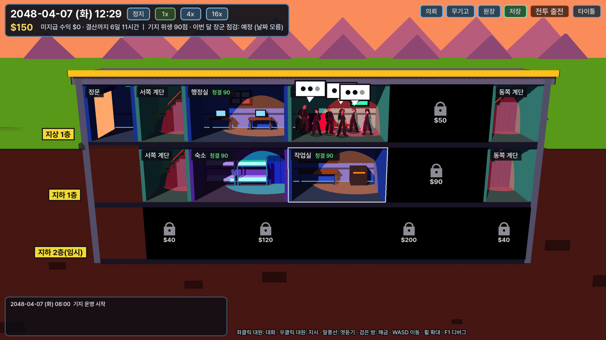
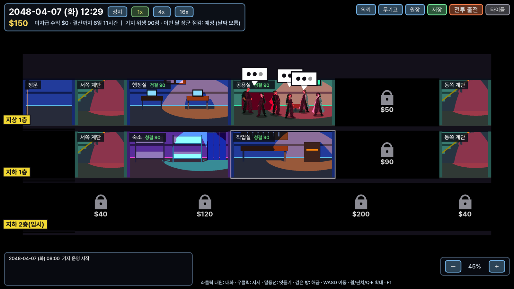
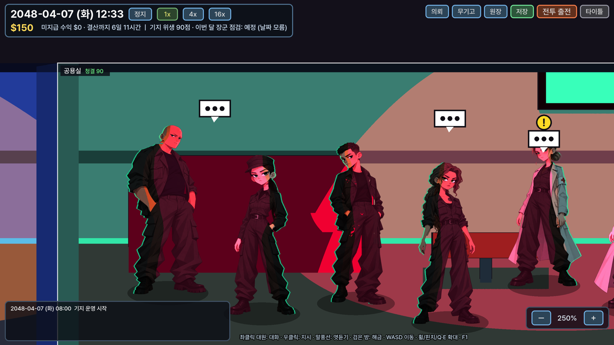

- **기지 화면**: 배경은 **3D 단면 건물**(방마다 원색 스폿 조명·하드 섀도우, 셀 셰이딩), 건물 바깥은 **검정**.
  카메라는 **정면처럼 반듯한 직교 뷰**(원근 없음 — 방마다 같은 크기 사각형, 한 칸 ≈ 정사각형)이고 **방 안만 위에서 살짝(18°) 내려다보는** 구도라 바닥이 보입니다.
  처음엔 대원들이 있는 지상 1층·지하 1층을 크게(화면 세로 9m) 보여 줍니다. 대원은 2D 캐릭터 스프라이트(프레임 애니메이션)를 그 위에 덧그림.
  3개 층 (지상 1층·지하 1층 기본 개방, 지하 2층(임시) 잠금). `WASD` 이동 · `F11` 전체 화면.
  **확대/축소**: 마우스 휠(커서 위치 기준) · Mac 트랙패드 핀치 또는 두 손가락 위아래 · `Q`/`E` 누르고 있기 · `-`/`+` · 오른쪽 아래 `－ 100% ＋` 버튼 · `0` = 기본.
  범위 45%~250% (화면 세로 20m~3.6m): 최대 확대는 대원 원화(전신 약 760px)가 QHD 화면에서 원화보다 커지지 않는 한계, 최대 축소는 기지 전체가 보이는 정도. 3D 배경은 늘 QHD 로 다시 그려 어느 배율에서도 선명.
  카메라 각도·확대(화면 세로 m)는 `scenes/outgame/base_hub.tscn` 루트 노드 인스펙터 **카메라** 그룹 (실행 중 원격 탭에서도 즉시 반영).
- **시간**: 2048-04-07 (화) 08:00 시작, 현실 1초 = 게임 1분 [임시]. 위쪽 `정지/1x/4x/16x`, `Space` 정지/재개. 창이 열려 있으면 시계가 멈춤.
- **대원 6명** (전투 아군과 같은 인물): 주간 일정대로 방을 오가며 생활 (수면·식사·업무·잡담…).
  - **좌클릭** = 직접 대화. 머리 위 **`!`** 가 있으면 요청 대화 → 수락.
  - 대원 둘이 같은 방에서 쉬면 **말풍선** → 클릭하면 엿듣기 (스토리 대화 포함).
  - **우클릭** = 지시: 청소(→ 장소 클릭) · 업무/외부 의뢰 · 훈련 · 정보·장비. 일부 대원(단)은 청소를 다른 대원에게 넘김.
- **위생**: 매일 0시에 해금된 방이 랜덤으로 더러워짐(쓰레기·얼룩, 방 이름표의 청결 점수). 청소하면 100.
- **재정 (USD)**: 7일마다 주간 결산(행정 지원금 + 그 주 작업·의뢰 수익). 수익은 완료 즉시 '미지급'으로 쌓였다가 결산 때 입금.
  **월 1회 랜덤 시각 장군 점검** → 기지 위생 점수로 만족도 → 그 주 결산에 보너스. 같은 거래는 원장 id 로 한 번만 반영.
- **훈련·제작·강화 → 전투**: 훈련 단계마다 전투 최대 HP +5, **무기고**(위쪽 `무기고` 버튼)에서 대원별 무기 3칸 장착·무기 제작(시간만)·강화(+1당 위력 +1). 기지에서 출전한 전투에 반영 [더미 수치].
- **계단**: 대원이 계단 칸의 지그재그 계단을 실제로 대각선으로 걸어 오르내립니다.
- **전투 발생**: `전투 출전` 버튼 말고도 기지 시간에 따라 전투가 일어납니다 (예시: 06:00 기준 **6시간마다** 00·06·12·18시). 발생하면 기지 시계가 멈추고 붉은 막대 `전투 배치로` → 편성 → 전투.
  규칙은 **Godot 에디터 상단 `전투 발생` 탭** (아래 참고).
- **체력·피로도·친밀도** (대원 좌클릭 → 카드): 체력(붉은) · 피로도(보라) · **친밀도(파스텔 노랑, 아웃게임에서만)** · 상태 이상.
  - 전투에서 잃은 체력은 기지로 그대로 돌아옵니다(쓰러지면 HP 1 + 부상). **상태 이상은 의무실 치료, 체력은 의무실 침대 휴식으로만 회복** — 우클릭 → `의무실로`.
  - 피로는 활동·전투로 오르고 **침대·소파·의자에서 잠을 잘 때만** 내려갑니다. 오브젝트마다 회복력이 다름(침대 > 의무침대 > 소파 > 의자). 대원은 침대에 눕고 의자·소파에 앉습니다.
  - 친밀도: 하루 첫 대화 +1, 요청 수락 +5, **PX(상점)** 에서 산 선물을 카드의 `선물하기`로. **대원마다 좋아하는 선물과 오르는 양이 다름**
    (단 가죽 장갑 +16 · 키라 행운 부적 +14 · 이선 문고본 +13 · 하나 초콜릿 +12 · 앨마 초콜릿 +9 · 니키타 캔커피 +8 …, 엑셀 `PX` 시트의 대원 열).
  - **친밀도 대화**: 친밀도 30·50·70·90 이 되면 새 대화가 해금되고 머리 위에 **♥**. 클릭해 대화하면 그 단계 대화가 나오고, 다 봤으면 해금된 가장 높은 단계 대화 (엑셀 `친밀도대화` 시트).
- **식당**: 시설 창에서 달러로 식재료 공급($20 → 12끼). 끼니마다 1끼 소모, 없으면 굶어서 피로 +.
- **저장**: 날짜가 바뀔 때·출전할 때·`저장` 버튼·타이틀로 갈 때 자동 저장 (`user://outgame_save.json`). 타이틀 `이어하기`로 불러옴.
- **디버그 `F1`**: +1시간 · 다음 날/주/달 · 오염 추가 · 점검 지금 · 달러 +100 · 전투 발생 · 대원별 상태·목적지·이유 · 이번 달 점검 예정 시각.
- **기지 데이터 = `data/outgame.xlsx`** (설정·층·시설·대원·의뢰·대사·대화이벤트·요청·제작 + 읽어보기). 시설 이름·대사·수치는 모두 **더미/임시값** — 엑셀에서 바꾸고 저장하면 실행 중인 게임에 1초 안에 반영.
- **대원 주간 일정 = Godot 에디터 상단 `일정` 탭** (`data/outgame/schedules/<대원 id>.json`): 7일 시간표, 블록(시작·끝·목적지·행동·해금 조건·잠기면 갈 곳),
  자주 머무는 장소, 청소 위임 성향, 시간 스크러버 미리보기(그 시각의 목적지·경로), 검사(경로 불가·겹침·잠긴 목적지·참조 누락), `기지 테스트 플레이`.

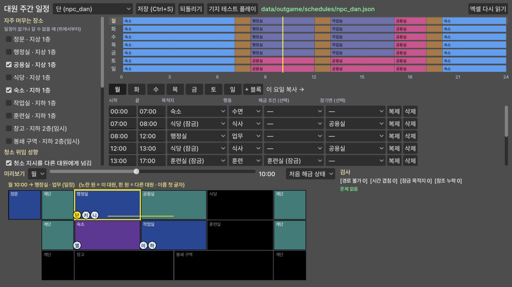

- **전투 발생 = Godot 에디터 상단 `전투 발생` 탭** (`data/outgame/battle_rules.json`): 규칙 추가·복제·삭제·순서, 방식(일정 간격 / 매일 정한 시각 / 한 번), 간격·기준 시각, 요일, 시작일, 스테이지(여럿이면 무작위), 넘기기 허용.
  아래에 게임 시작부터 7일 동안의 발생 시각 타임라인·다음 발생 목록·검사(형식 오류·없는 스테이지·7일 안에 발생 안 함). 저장(Ctrl/Cmd+S) → `기지 테스트 플레이`는 다음 전투 10분 전부터 새 기지 실행.

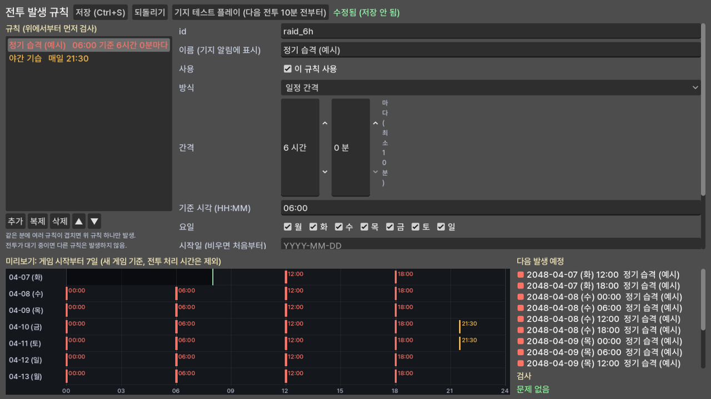
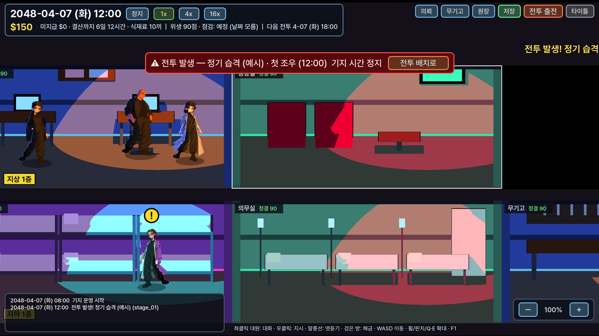
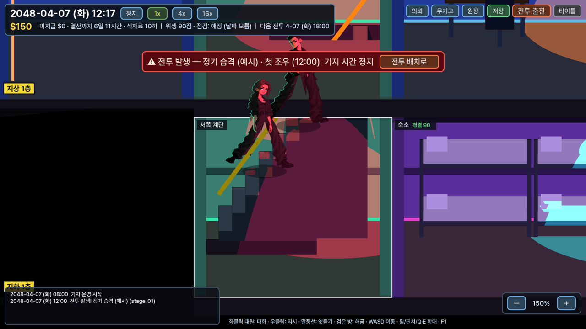
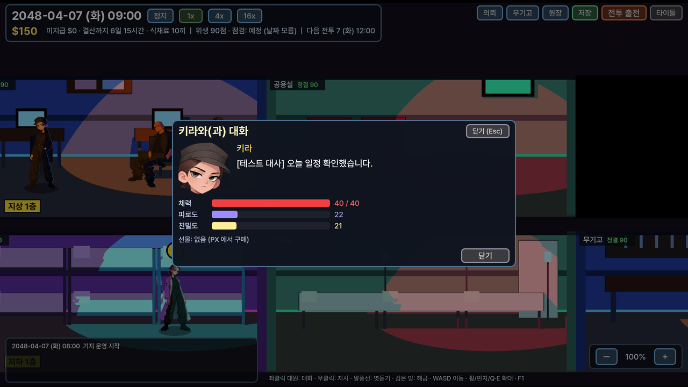
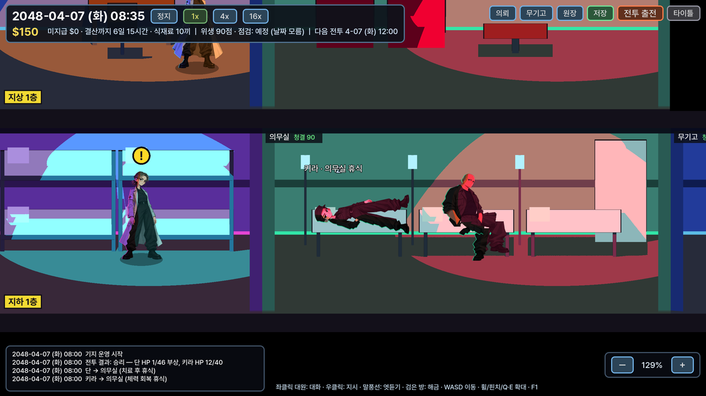
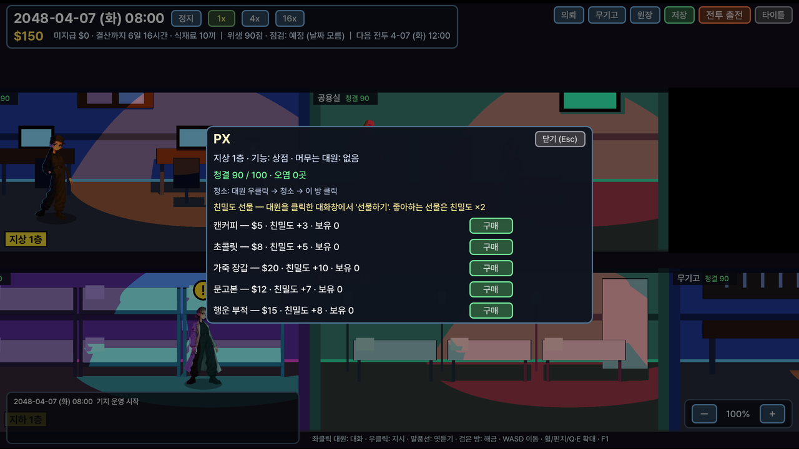
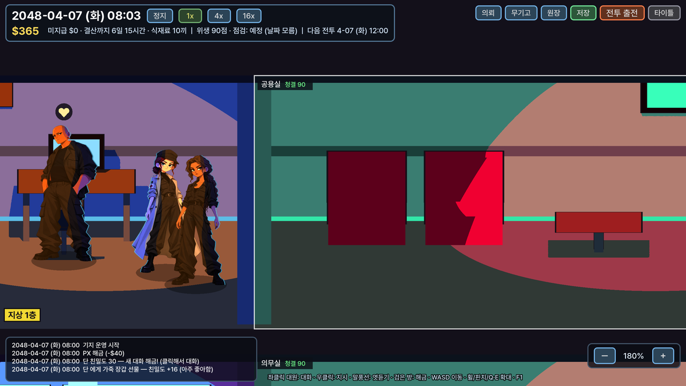
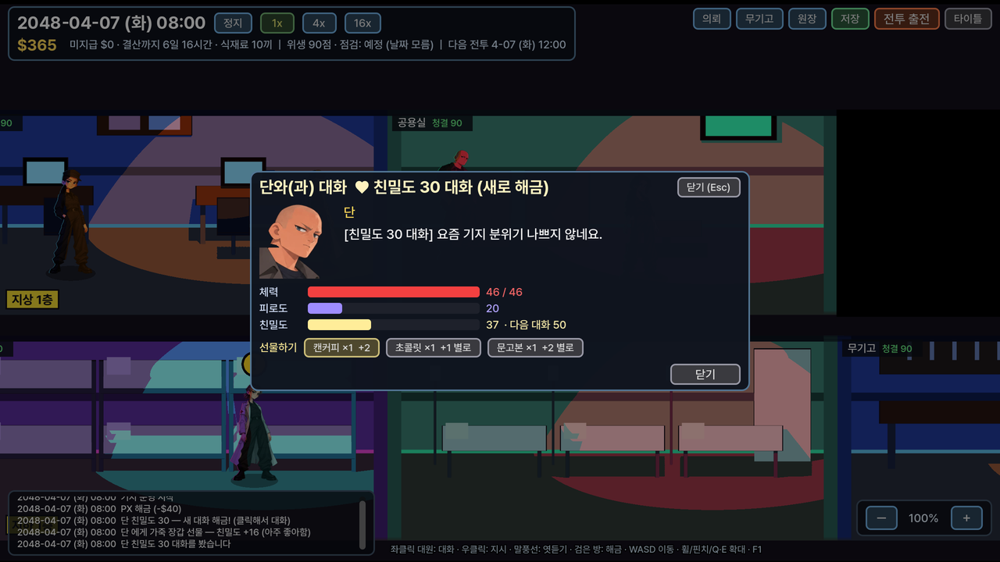
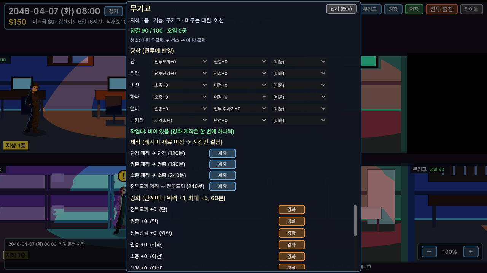

## 밸런스 데이터 (엑셀) · AI 에디터 · 스테이지 에디터
에디터 네 개는 Godot 에디터 플러그인(`addons/rtz_ai_editor`, `addons/rtz_stage_editor`, `addons/rtz_schedule_editor`, `addons/rtz_battle_editor`)으로, `./play.sh edit` (Windows `play.bat edit`) 로 에디터를 열면 상단 탭에 `AI` · `스테이지` · `일정` · `전투 발생` 이 있습니다.
**밸런스 수치는 `data/balance.xlsx`** 한 파일에 시트별로 있습니다: `캐릭터` · `몬스터` · `아이템` · `스킬` · `스테이지` (+ 열 설명 `읽어보기`).
- 엑셀(또는 Numbers·LibreOffice)로 열어 고치고 **저장하면 1초 안에 게임이 다시 읽어 바로 적용** — 진행 중인 전투의 HP·AP·위력·이름까지.
  캐릭터 추가·편성·적 배치처럼 전투 구성이 바뀌는 것은 다음 전투(R 재시작)부터.
- 열 이름(1행)으로 찾으므로 열 순서는 바꿔도 되고, 행을 추가하면 새 캐릭터·몬스터·스킬·스테이지가 됩니다. 다른 시트에서 쓰는 이름은 `id` 열.
- 잘못된 참조(없는 무기·스킬 id 등)는 전투 중 알림과 콘솔 경고로 알려줍니다.

**AI 에디터** (Godot 에디터 상단 `AI` 탭 — 2D · 3D · Script 옆): 몬스터 AI 를 노드로 연결해 만듭니다 → `data/ai/<이름>.json`.
- 노드: 시작 / 조건(이번 턴 행동 수·AP·HP·우리 편 HP·상대 수·스킬 사용 가능·처치 가능·확률 → 예/아니오) / 스킬 사용(스킬·대상 고르기, 안 되면 '실패 시') / 턴 종료.
- 행동 하나마다 시작부터 다시 평가. 저장(버튼 또는 Ctrl/Cmd+S)하면 실행 중인 게임에도 바로 반영.
- 엑셀에서 스킬·몬스터를 바꿨으면 오른쪽 위 `엑셀 다시 읽기`.
- 어떤 몬스터가 어떤 AI 를 쓸지는 엑셀 `몬스터` 시트의 `AI` 열. 기본 제공: `default`(구울·슬라임), `aggressive`(늑대).

**스테이지 에디터** (Godot 에디터 상단 `스테이지` 탭): 스테이지별 적 배치를 칸에 놓아 만듭니다 → `data/stages/<스테이지 id>.json`.
- 왼쪽에서 몬스터를 고르고 칸 클릭 = 배치(2칸 몬스터는 두 칸), 배치된 몬스터 클릭/우클릭 = 제거, 저장 → `테스트 플레이`(에디터에서 그 스테이지로 전투 실행, F8 로 종료).
- 스테이지 목록·이름·조명·선공·적 HP/공격 배율·시드는 엑셀 `스테이지` 시트 (행 추가 = 새 스테이지). 메뉴의 `스테이지` 에서 골라 플레이.

## 전투 HUD 위치 편집 (Godot 에디터)
전투 HUD 의 배치는 `scenes/battle_hud.tscn` 에 노드로 저장돼 있어 에디터에서 직접 보고 옮길 수 있습니다.
1. `./play.sh edit` (Windows `play.bat edit`) 로 에디터를 열고, 파일 시스템 창에서 `scenes/battle_hud.tscn` 더블클릭.
2. 씬 트리에서 노드를 골라 화면에서 끌어 옮기거나, 인스펙터 **Layout → Transform/Anchors** 의 위치·크기(offset)를 고칩니다.
3. `Ctrl+S`(맥 `Cmd+S`) 저장 → 게임 실행하면 바로 반영.

| 노드 | 화면 요소 |
|---|---|
| `TopBar/TopRow/RoundLabel` | 좌상단 "라운드 N" |
| `Timeline` | 상단 중앙 행동 순서 초상화 줄 (초상화는 실행 중에 채워짐, 에디터에선 빈 상자) |
| `LogButton` / `LogPanel` | 우상단 전투 기록 아이콘 / 펼친 기록 창 |
| `PresetLabel` | 조명 프리셋 안내 글자 |
| `Bottom` (`BottomRow` 안: `PortraitFrame`, `Info`, `Spacer`, `EndTurnWrap/EndTurn`) | 하단 패널 전체·초상화·이름/수치·턴 종료 |
| `SlotsRow` | 하단 가운데 무기·자리 이동·스킬·필살기 슬롯 줄 (실행 중에 채워짐) |
| `StatusWindow` | 상태 이상 창 |
| `ResultBanner`, `Toast`, `DebugPanel` | 승패 글자, 알림, F1 디버그 창 |

- 컨테이너(`BottomRow`, `Info` 등) 안의 노드는 컨테이너가 자리를 정하므로 직접 끌 수 없습니다. 순서(씬 트리에서 위/아래로 끌기), 최소 크기(`custom_minimum_size`),
  간격(Theme Overrides → Constants → separation)으로 조정합니다.
- 슬롯 하나하나의 크기(스킬 75px, 무기 44×112 등)·색은 `scripts/ui/battle_hud.gd` 상단 상수(`SLOT`, `WEAPON_W` …)에서 바꿉니다.
- `godot --headless --path . ++ --export_hud=1` 은 코드 기본값으로 `battle_hud.tscn` 을 **다시 만들어 편집한 배치를 덮어씁니다** (처음 생성용).
- 맥에서 배치를 고친 뒤 `git pull` 을 하면 충돌할 수 있으니, 고친 `battle_hud.tscn` 은 커밋하거나 알려 주세요.

## 카메라 각도 조절 (인스펙터)
에디터에서 `scenes/battle_2d.tscn` 을 열고 `View` 노드를 선택 → 인스펙터 **카메라** 그룹:
`Cam Pitch Deg`(내려다보는 각도) · `Cam Distance`(거리) · `Cam Fov Deg`(화각) · `Cam Target`(바라보는 바닥 위 점) · `Cam Screen Center`(그 점이 놓이는 화면 위치).
저장 후 실행하면 캐릭터 위치·크기, 3D 배경, 조명, 그림자가 그 구도로 맞춰집니다. 게임 실행 중에는 씬 트리의 **원격(Remote)** 탭 → `Battle2D/View` 를 골라 값을 바꾸면 즉시 반영.
(캐릭터 원화 자체는 평면 그림이라 각도를 바꿔도 그림이 다시 그려지지는 않습니다.)

아트 규격(아이콘·초상화·UI): `docs/ui_art_spec.md`

## 실행
1. 위 설치 스크립트를 썼다면 `play.bat` / `play.sh`. 직접 설치한 Godot 4.7 (stable) 로 이 폴더를 열어 F5 해도 됩니다. 메인 씬 `scenes/title.tscn` (타이틀).
2. 타이틀 `게임 시작` → 기지 (위 '게임 루프' 참고). 전투만 따로 보려면 타이틀 `전투 테스트 메뉴 (개발용)`: 조명 프리셋(G1~G4), 선공(동전/아군 기습/적 매복), 시드를 고른 뒤 편성 → 전투 (기지 성장 반영 없음).
3. 화면: 창은 **QHD(2560×1440 픽셀)** 로 고정해 그 해상도로 렌더합니다(모니터가 작으면 16:9 로 맞춰 줄임). `F11` 전체 화면.
4. 전투 시작: 일반 전투(동전)는 화면 아래에서 금화가 튀어 올라 오른쪽으로 돌며 떨어집니다 — **고양이 면(앞면) = 아군 선공, 매끈한 면(뒷면) = 적 선공**.
   착지 후 "아군 선공"/"적 선공" 글자가 잠깐 뜹니다.
   상단 중앙에 행동 순서가 초상화로 나오고(마우스를 올리면 이름), 차례인 캐릭터의 초상화가 30% 커집니다.
   전투 기록은 우측 상단 아이콘만 보이다가 아이콘 클릭(또는 `L`)으로 기록 창을 펼칩니다. 글꼴은 Pretendard.
5. 전투 중 단축키: `1~4` 조명 프리셋 즉시 교체 · `L` 전투 기록 펼치기 · `F1` 디버그 패널 · `F2` HUD 숨김 · `F3` 캐릭터 림 라인 켜기/끄기 · `R` 재시작 · `Space` 턴 종료 · 우클릭 취소.

렌더러는 `gl_compatibility` 로 두었습니다(저사양/소프트웨어 렌더 검증 포함). Forward+ 로 바꿔도 셰이더는 그대로 동작합니다.

## 카메라 (2D 전투)
2D 전투는 정면 평면이 아니라 **뒤로 물러나 40° 내려다보는 가상 카메라**로 구성됩니다. `tools/gen_sprites.py` 의 `CAMERA`
(피치 40°, 거리 15m, 세로 화각 32°, 화면 중심 y 480 — 벽이 더 보이고 바닥이 덜 보이게 구도를 위로)로 배경(바닥 원근·벽·소품·빛 영역 마스크)을 그리고, 같은 값이
`manifest.json` 의 `camera` 로 저장되어 `BattleView2D` 가 슬롯 위치와 캐릭터 크기(원근 배율)를 계산합니다.
각도나 거리를 바꾸려면 `CAMERA` 를 수정하고 `python3 tools/gen_sprites.py` 를 다시 실행하면 배경과 배치가 함께 바뀝니다.
3D 뷰도 같은 각도(40°)로 맞춰 두었습니다.

## 전투 편성 (게임 기본)
게임은 **사용자 제공 원화 캐릭터만** 배치합니다 (6대2, `TestRoster.build_provided_*`):
- 아군(사람 6인): 단(돌격병 185cm, 전방)·키라(돌격병 175cm, 전방)·이선(소총수 178cm, 중앙)·하나(돌격소총수 176.8cm, 중앙)·앨마(의무병 166cm, 후방)·니키타(저격수 168cm, 후방)
- 적(괴물, 적으로만 등장): 구울(2.4m) — **전방+중앙 두 칸 차지** (`UnitData.row_span = 2`), 늑대(4m) — 후방 한 칸
  두 칸 괴물은 살아 있는 동안 전방을 막고(근접은 괴물부터), 자리 이동·교환을 하지 않으며, 두 칸의 가운데에 선다.
도형으로 생성한 12인(`build_allies/build_enemies`)은 규칙 테스트에서만 씁니다.
새 캐릭터 추가: `assets/characters/<id>/` 폴더(아래 '캐릭터 스프라이트 애니메이션') → 로스터에 `sprite_id: "<id>"`, `height_cm` 으로 등록.
캐릭터 키는 `character.json` 의 `figure_px`(원화 정수리~발 픽셀)를 화면 230px = 175cm 기준으로 환산해 2D·3D 모두에 반영됩니다.

## 배경 3D + 캐릭터 2D (하이브리드, 기본)
2D 전투의 배경은 3D 방(창·문 밖 스폿라이트, 하드 섀도우, 셀 셰이더)을 2D 가상 카메라와 **같은 투영**으로 렌더한 텍스처입니다
(`BattleView3D.configure_as_background` / `set_view`, QHD 해상도로 카메라가 움직이거나 위치·프리셋이 바뀔 때만 다시 렌더).
캐릭터는 2D 스프라이트 그대로이고, 자기 위치에 실제로 닿는 빛(원뿔 범위, 창·문 개구부 통과, 문짝 가림)을 `light_probe` 로 계산해 명암을 정합니다.
- 빛 쪽 얼굴·몸을 그 광원색으로 밝히고 반대편은 셀 그림자.
- 빛이 뒤(벽의 창·문)에서 오면 **빛 쪽 가장자리에 같은 색 림**을 더함(반대 방향 마스크의 림 구역 사용). 반대편 림은 그쪽에서 실제 빛이 올 때만.
- 보이지 않는 그림자 대리 물체로 캐릭터 그림자가 바닥에 드리워집니다.
이전 2D 원화 배경은 `--bg=2d` 로 볼 수 있습니다. 투영 확인용 `--bgdebug=1`(슬롯 위치 빨간 점).

## 전투 카메라
전투가 시작되면 먼저 전장 전체 구도를 약 1초 보여준 뒤 2배로 줌인하고, 이후 차례가 온 캐릭터의 몸 중심을 화면 가운데
(상단 바와 하단 명령 패널 사이 중앙)로 옮깁니다. 3D 배경은 2D 카메라의 위치·줌을 그대로 따라 다시 그려서, 줌을 해도 흐려지지 않고
화면 가장자리 캐릭터도 정확히 중앙에 올 수 있습니다. 배경 밖은 보이지 않게 제한합니다. 값은 `battle_view_2d.gd` 의 `CAM_*` 상수.
스크린샷 CLI 는 기본으로 인트로를 건너뛰며 `--intro=1`(재생), `--intro=hold`(전체 구도에서 멈춤)로 바꿀 수 있습니다.

## 캐릭터 스프라이트 애니메이션 (스프라이트 시트, Skeleton2D 리그는 제거)
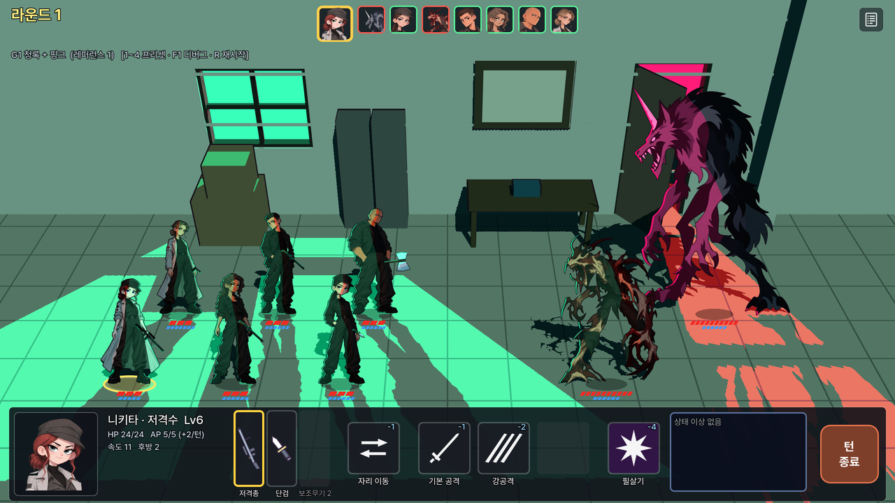

캐릭터(전투·기지 공통)는 **직접 뽑은 스프라이트 프레임**으로 움직입니다. 폴더: `assets/characters/<id>/`
(`dan` 단 · `kira` 키라 · `ethan` 이선 · `hero2` 하나 · `alma` 앨마 · `nikita_army` 니키타 · `ghoul` 구울 · `wolf` 늑대 · `slime`).
- `base.png` = 기본 한 장 (지금은 예전 리그를 쉬는 자세로 합친 원화). **애니메이션 프레임이 없는 동작은 이 그림이 그대로 서 있거나 미끄러지듯 이동**합니다.
- **스프라이트 시트 넣기 (기본 방법)**: 시트 한 장을 `assets/characters/<id>/` 에 **`<동작>_<칸 수>.png`** (한 줄) 또는 **`<동작>_<열>x<행>.png`** 이름으로 두면 끝.
  예: `assets/characters/kira/walk_8.png` (8칸 한 줄), `assets/characters/kira/attack_4x2.png` (4열 2행, 빈 칸은 건너뜀). 칸은 모두 같은 크기, 왼쪽 위부터 오른쪽으로.
  **발 위치·키는 첫 칸 그림에서 자동** (그림 맨 아래 가운데 = 발, 그림 높이 = 키 → 캐릭터 키(cm)에 맞춰 크기 조절). 칸 안에서 캐릭터가 움직이는 만큼은 그대로 움직입니다.
  속도·반복 등은 같은 이름 json(선택): `walk.json` = `{"fps": 10, "loop": true, "ground": [x, y], "figure_px": 키 픽셀, "weapon": false, "durations": [초, …]}`.
- 여러 동작을 한 장에: `sheet.png` + `sheet.json` = `{"cols": 8, "rows": 4, "anims": {"idle": {"row": 0, "count": 6, "fps": 8}, "walk": {"row": 1, "count": 8}, …}}`.
- 프레임 낱장으로도 됨: `assets/characters/<id>/<동작>/0001.png, 0002.png …` (이름 순서대로 재생, 기본 12fps).
  **캔버스 크기·발 위치를 `base.png`(512×768, 발 접지점 `character.json` 의 `ground`)와 같게** 그리면 따로 설정할 것이 없습니다.
  다르면 그 폴더에 `anim.json`: `{"fps": 12, "loop": true, "ground": [x, y], "figure_px": 정수리~발 픽셀, "hip_y": 골반 y, "weapon": false}`.
- 동작 이름: 기지 `idle`(서 있기) · `walk`(이동) · `sit`(의자·소파, 골반 높이 = `hip_y`) · `sleep`(누워 자기, 눕혀 그린 그림·접지점 = 침대에 닿는 몸 가운데) ·
  `work`(업무·치료) · `clean`(청소, 없으면 work) · `train`(훈련, 없으면 work) · `talk`(대화) / 전투 `idle` · `attack` · `hit` · `heal` · `death`(마지막 프레임 유지).
  attack·hit·heal 은 한 번 재생 후 idle. 프레임이 없으면: 앉기 → 의자 앞에 서 있음, 자기 → 기본 그림을 눕힘, 전투 동작 → 간단한 앞뒤 이동·흔들림.
- 무기: 전투에서 손 위치(`character.json` 의 `hand`)에 무기 그림을 붙입니다. 무기를 직접 그린 동작은 `anim.json` 에 `"weapon": false` (attack·hit·heal·idle 외 동작은 기본으로 숨김).
- 조명(셀 명암) 마스크: 프레임·시트만 넣어도 동작합니다(마스크 없이 고른 조명). 방향 있는 명암을 원하면 `python3 tools/char_sprites.py masks` → 프레임·시트마다 `_mask_l/_r.png` 생성 (시트를 주시면 제가 만들어 둡니다).
- 새 프레임은 게임을 다시 켜면 바로 반영 (임포트 기다릴 필요 없음).
- (선택) 움직이는 GIF·WebP → 프레임 변환: `python3 tools/char_sprites.py import nikita_army hit 파일.webp` (조명 마스크까지 만듦).
  ※ 채팅에 올린 움직이는 이미지는 첫 장면 한 장으로만 전달되므로, 시트 한 장으로 주거나 저장소에 넣어 커밋해 주세요.
- 프레임마다 보여 줄 시간을 다르게: `anim.json` 의 `"durations": [2.4, 1.2]` (초, fps 대신).
- **들어간 애니메이션** (사용자 제공 시트): 니키타 `idle_4x4`(8fps) · `walk_6x6`(15fps) · `hit_6x6`(버티는 동작, 24fps) · `attack_6x6`(가리키는 동작, 24fps) /
  키라 `idle_4x4`(8fps) · `walk_4x4`(12fps) · `hit_4x4`(20fps) · `attack_4x4`(팔 휘두르기, 20fps) / 하나(`hero2`) `walk_4x4`(12fps) · `hit_4x4`(20fps) · `attack_4x4`(20fps).
  단·이선·앨마 `idle_4x4` = **기본 그림으로 만든 숨쉬기**(`python3 tools/char_sprites.py breathe <캐릭터>` — 원화 픽셀만 살짝 늘여 상체가 오르내림, 발 고정). 직접 그린 시트로 바꾸면 그 파일을 덮어쓰면 됨.
  속도는 같은 이름 json(`walk.json` 등). 조명 마스크 시트(`*_mask_r/_l.png`)는 `python3 tools/char_sprites.py masks` 로 칸마다 만듦 — 없어도 동작.

## 규칙 테스트 (헤드리스)
```
godot --headless --path . --import          # 최초 1회 (클래스 캐시 생성)
godot --headless --path . -s tests/run_tests.gd
```
전투: GDD 8절 "필수 검증 사례" (선공 특례, 2라운드 미적용, 동률 아군/레벨/원거리 우선, AP 상한 버림/이월/0 자동 종료,
이동/교환 AP 1, 무기 변경 AP 1, AP 부족/무효 대상 시 AP 미소모, 재시작 초기화, 시드 재현성) + 큰 몸집·장착·상태 이상·엑셀·AI 그래프.
기지([15]~[24], `tests/outgame_tests.gd`): 날짜 전환(23:59→다음 날·월말·연말), 해금(부족/정확/초과/중복), 잠긴 방 경로·7일 이동, 요일별 일정·해금 → 생활 변화,
대화/엿듣기/요청 구분, 일일 오염·청소·위임, 주간 결산 중복 없음, 월 1회 점검·그 주 보너스, 훈련·제작·강화 → 전투 수치, 저장/불러오기 복구. 현재 197개 통과.

## 스크린샷 일괄 렌더
```
GODOT=/path/to/godot tools/render_shots.sh docs/screenshots      # Xvfb + Mesa 소프트웨어 렌더, QHD 출력
```
CLI 인자(`++` 뒤): `--scene=battle|formation|result|menu|title|base --mode=2d|3d --preset=g1..g4 --shot=경로 --autoplay=aim|move|fight:N --hud=0`.
디버그: `--charview=1`(캐릭터 원화를 조명 없이 출력), `--outline=0`(외곽선 끔), `--rim=0`(림 끔).
기지: `--scene=base --base_skip=분 --base_cam=x,y,화면높이(m) --base_ui=dialogue:npc_alma|overhear|unlock:f1_mess|facility:b1_workshop|character:npc_kira|contracts|context:npc_dan|clean:npc_kira|debug|sortie|unlockall`.

## 폴더
```
scenes/            title, main_menu(전투 테스트), formation, battle_2d, battle_3d, battle_hud, result, outgame/base_hub
scripts/battle/    규칙 계층 (표현 비의존): unit_data, action_data, unit_runtime, slot_manager,
                   turn_scheduler, ap_component, target_validator, action_resolver, enemy_ai, battle_controller
scripts/presentation/  battle_view_base (공통 인터페이스), battle_view_2d + unit_sprite_2d + character_sprite_2d(프레임 애니메이션) + slot_marker_2d,
                   battle_view_3d + unit_model_3d, lighting_presets
scripts/ui/        battle_hud, title, main_menu, formation, result
scripts/outgame/   기지 규칙 (화면 비의존): outgame_data(엑셀·일정·단면 좌표), world_clock, room_route_service, npc_schedule_resolver,
                   npc_agent, economy_ledger, base_sim(해금·이동·대화·위생·의뢰·결산·점검·제작·저장) / base_hub(씬)
scripts/outgame/view/  base_view_3d(3D 단면 건물·조명·카메라), base_overlay(이름표·자물쇠·오염·말풍선 — 화면 좌표), npc_view(대원 스프라이트), outgame_hud(HUD·창)
addons/            rtz_ai_editor, rtz_stage_editor, rtz_schedule_editor, rtz_battle_editor (Godot 에디터 상단 탭)
data/              balance.xlsx(전투), outgame.xlsx(기지), ai/, stages/, outgame/schedules/
scripts/data/      test_roster (임시 테스트 데이터 12인 + 행동 7종)
shaders/           cel_zoned_lighting (2D 배경, v0.3), cel_character (2D 캐릭터), outline_group (캐릭터 외곽선), flat_zone_fill, cel_3d, outline_3d, unlit_3d
assets/characters/ 캐릭터별 base·프레임 애니메이션·마스크·character.json (전투·기지 공통)
assets/sprites/    무기 스프라이트 + 구역 마스크 (_mask_r/_mask_l) + 옛 테스트 캐릭터 + manifest.json
assets/textures/   배경 플레이트 + 마스크, 3D 얼굴 데칼
setup/             install_windows.ps1, install.sh (기기 설치), play.bat / play.sh / play.command (루트, 실행)
tools/             gen_sprites.py (원화·마스크 생성기), char_sprites.py (애니메이션 프레임 조명 마스크), render_shots.sh,
                   gen_balance_xlsx.py / gen_outgame_xlsx.py (엑셀·일정 초기 생성 — 이미 있으면 덮어쓰지 않음)
tests/             run_tests.gd, outgame_tests.gd
docs/              design/ (기획서 사본, outgame/ = 아웃게임 기획 01~04 + 구현 현황 05), screenshots/, 2D_vs_3D_comparison.md
```

## 데이터 흐름
`BattleController` 가 상태 머신(PREPARE → INITIATIVE → ROUND_START → ACTOR_START → PLAYER_COMMAND/ENEMY_AI → ACTION_RESOLVE → …)을 돌리며
신호만 내보내고, `BattleView2D`/`BattleView3D` 는 같은 `BattleViewBase` 인터페이스로 그 신호를 연출로 바꿉니다.
모든 행동은 `can_execute → pay_ap → resolve → emit_event` 한 경로(`BattleController._execute`)를 지납니다.

## 임시 에셋 주의
캐릭터/배경은 `tools/gen_sprites.py` 가 도형으로 생성한 **검증용 대체 원화**입니다. 레퍼런스 이미지는 포함하지 않았습니다.
