# RT Zerosum — 전투 + 기지(아웃게임) 플레이어블 프로토타입 (Godot 4.7)

횡스크롤 턴제 6인 AP 전투 프로토타입. `docs/design/PROTOTYPE_GDD_v1_0.md` 의 확정 규칙과 임시값을 구현했고,
**같은 전투 규칙 위에 2D 표현(원화 + 구역 마스크 셰이더)과 3D 표현(셀 셰이더 + 실광원) 두 가지 뷰**를 올려
그래픽 방향(2D vs 3D)을 비교·결정할 수 있게 했습니다. 비교 결과는 `docs/2D_vs_3D_comparison.md` 참조.

## 설치 (노트북·데스크톱 공통, 명령 한 줄)
각 기기의 `/Users/eunjikim/Game/zerosum` (= `~/Game/zerosum`, Windows 는 `C:\Users\<이름>\Game\zerosum`)에 프로젝트를 받고,
Godot 4.7 이 없을 때만 macOS 는 `/Applications/Godot.app` 하나에 설치해 바로 실행합니다(이미 있으면 재사용). 저장소가 공개라 GitHub 로그인은 필요 없습니다.

**Windows** — 시작 메뉴에서 PowerShell 을 열고 붙여넣기:
```powershell
irm https://raw.githubusercontent.com/HomilBBANG/rt_zerosum/main/setup/install_windows.ps1 | iex
```
설치가 끝나면 바탕화면에 **RT Zerosum** 바로가기가 생깁니다. 이후 실행은 바로가기 또는 `Game\zerosum\play.bat`.

**macOS (노트북·컴퓨터 공통)** — 터미널에 붙여넣기:
```bash
curl -fsSL https://raw.githubusercontent.com/HomilBBANG/rt_zerosum/main/setup/install.sh | bash
```
이후 실행은 Finder 에서 `Game/zerosum/play.command` 더블클릭, 또는 `~/Game/zerosum/play.sh`.
`~/Game/zerosum` 폴더가 이미 있고 다른 파일이 들어 있어도 지우지 않고 그 자리에 연결합니다. 저장소 파일과 이름이 겹치는 기존 파일(예: Godot 가 만든 `.gitignore`)은 `_backup_before_install_날짜/` 폴더로 옮겨 둡니다.

**Godot 가 여러 개 깔렸을 때**: 아래 명령이 Mac 의 Godot 를 모두 찾아 목록을 보여주고, y 를 입력하면 4.7 하나만
`/Applications/Godot.app` 에 남기고 나머지는 휴지통으로 옮깁니다(Finder 휴지통에서 복구 가능).
```bash
curl -fsSL https://raw.githubusercontent.com/HomilBBANG/rt_zerosum/main/setup/cleanup_godot.sh | bash
```

**업데이트**: 프로젝트 폴더에서 `git pull` 만 하면 됩니다 → 그다음 평소처럼 `play.command` / `play.sh` / `play.bat` 실행.
새 원화·애니메이션이 들어온 커밋이면 실행 스크립트가 알아서 리소스를 다시 임포트합니다(커밋이 바뀐 첫 실행에만, 최대 1~2분).
```bash
cd ~/Game/zerosum && git pull
```
git 이 없는 설치(zip)는 같은 설치 명령을 다시 실행하면 최신으로 받아옵니다.
**에디터로 열기**: `play.bat edit` / `./play.sh edit`.
**다른 폴더에 설치**: macOS `curl ... | GAME_DIR=/경로 bash`, Windows `$env:GAME_DIR="D:\Game"` 를 먼저 지정.

> git 이 설치돼 있으면 두 기기 모두 `git pull` 로 같은 코드를 맞출 수 있습니다. 한쪽에서 수정한 뒤 다른 쪽에서 받으려면
> 수정한 기기에서 `git push` 할 권한(HomilBBANG/rt_zerosum 저장소 협업자)이 필요합니다.

## 게임 루프 · 아웃게임(기지 운영)
**타이틀 → 게임 시작(또는 이어하기) → 기지 → `전투 출전` → 전투 배치(편성) → 전투 → 결과 → `기지로 복귀`** [임시 루프, 바뀔 수 있음].
기획: `docs/design/outgame/01~04` (사용자 제공), 구현 현황·수용 기준 대응표: `docs/design/outgame/05_IMPLEMENTATION_STATUS.md`.


- **기지 화면**: 배경은 **3D 단면 건물**(방마다 원색 스폿 조명·하드 섀도우, 셀 셰이딩), 건물 바깥은 **검정**.
  카메라는 **정면처럼 반듯한 직교 뷰**(원근 없음 — 방마다 같은 크기 사각형, 한 칸 ≈ 정사각형)이고 **방 안만 위에서 살짝(18°) 내려다보는** 구도라 바닥이 보입니다.
  처음엔 대원들이 있는 지상 1층·지하 1층을 크게(화면 세로 9m) 보여 줍니다. 대원은 2D 캐릭터 스프라이트(프레임 애니메이션)를 그 위에 덧그림.
  3개 층 (지상 1층·지하 1층 기본 개방, 지하 2층(임시) 잠금). `WASD` 이동 · `F11` 전체 화면.
  **확대/축소**: 마우스 휠(커서 위치 기준) · Mac 트랙패드 핀치 또는 두 손가락 위아래 · `Q`/`E` 누르고 있기 · `-`/`+` · 오른쪽 아래 `－ 100% ＋` 버튼 · `0` = 기본.
  범위 45%~250% (화면 세로 20m~3.6m): 최대 확대는 대원 원화(전신 약 760px)가 QHD 화면에서 원화보다 커지지 않는 한계, 최대 축소는 기지 전체가 보이는 정도. 3D 배경은 늘 QHD 로 다시 그려 어느 배율에서도 선명.
  카메라 각도·확대(화면 세로 m)는 `scenes/outgame/base_hub.tscn` 루트 노드 인스펙터 **카메라** 그룹 (실행 중 원격 탭에서도 즉시 반영).
- **시간**: 2048-04-07 (화) 08:00 시작, 현실 1초 = 게임 1분 [임시]. 위쪽 `정지/1x/4x/16x`, `Space` 정지/재개. 창이 열려 있으면 시계가 멈춤.
- **대원 6명** (전투 아군과 같은 인물): 주간 일정대로 방을 오가며 생활 (수면·식사·업무·잡담…).
  - **대원 클릭 = 선택** (발밑 노란 고리 + 오른쪽 아래 카드). 선택한 대원을 **한 번 더 클릭 = 대화** (머리 위 **`!`** 면 요청 → 수락). `Tab` 다음 대원, `Esc`·빈 곳 클릭 = 선택 해제.
  - 대원을 선택한 채 **방 클릭 = 그 위치로 걸어감**, **더블클릭 = 뛰어감** (걷는 중에 더블클릭해도 뛰기로 바뀜, 뛰면 2.2배 빠르고 피로 +). 선택 없이 방 클릭 = 시설 창.
  - **도착하면 그 방에서 우클릭(방이나 대원) = 그 방에서 할 행동**: 숙소 잠자기·쉬기 / 공용실 쉬기·잠자기(소파) / 식당 식사 / 훈련실 훈련 / 의무실 치료·휴식 /
    행정실·정문 업무·의뢰 / 무기고·PX 창 열기 / 청소 구역이면 이 방 청소. 아래쪽 '어디서나' = 다른 방 청소·업무·훈련실로·의무실로·**지시 그만두기**.
  - 직접 보낸 대원은 그 방에 머물며(지시 대기) 행동하다가 **다음 일정 블록이 시작되면 일정대로** 돌아감 (잠자기는 피로 0 이 되면 일어남).
  - 대원 둘이 같은 방에서 쉬면 **말풍선** → 클릭하면 엿듣기 (스토리 대화 포함).
  - 청소 지시(어디서나 → 장소 클릭)는 일부 대원(단)이 다른 대원에게 넘김. '이 방 청소'는 본인이 함.
- **위생**: 매일 0시에 해금된 방이 랜덤으로 더러워짐(쓰레기·얼룩, 방 이름표의 청결 점수). 청소하면 100.
- **재정 (USD)**: 7일마다 주간 결산(행정 지원금 + 그 주 작업·의뢰 수익). 수익은 완료 즉시 '미지급'으로 쌓였다가 결산 때 입금.
  **월 1회 랜덤 시각 장군 점검** → 기지 위생 점수로 만족도 → 그 주 결산에 보너스. 같은 거래는 원장 id 로 한 번만 반영.
- **훈련·제작·강화 → 전투**: 훈련 단계마다 전투 최대 HP +5, **무기고**(위쪽 `무기고` 버튼)에서 대원별 무기 3칸 장착·무기 제작(시간만)·강화(+1당 위력 +1). 기지에서 출전한 전투에 반영 [더미 수치].
- **계단**: 대원이 계단 칸의 지그재그 계단을 실제로 대각선으로 걸어 오르내립니다.
- **전투 발생**: `전투 출전` 버튼 말고도 기지 시간에 따라 전투가 일어납니다 (예시: 06:00 기준 **6시간마다** 00·06·12·18시). 발생하면 기지 시계가 멈추고 붉은 막대 `전투 배치로` → 편성 → 전투.
  규칙은 **Godot 에디터 상단 `전투 발생` 탭** (아래 참고).
- **체력·피로도·친밀도** (대원 좌클릭 → 카드): 체력(붉은) · 피로도(보라) · **친밀도(파스텔 노랑, 아웃게임에서만)** · 상태 이상.
  - 전투에서 잃은 체력은 기지로 그대로 돌아옵니다(쓰러지면 HP 1 + 부상). **상태 이상은 의무실 치료, 체력은 의무실 침대 휴식으로만 회복** — 우클릭 → `의무실로`.
  - 피로는 활동·전투로 오르고 **침대·소파·의자에서 잠을 잘 때만** 내려갑니다. 오브젝트마다 회복력이 다름(침대 > 의무침대 > 소파 > 의자). 대원은 침대에 눕고 의자·소파에 앉습니다.
  - 친밀도: 하루 첫 대화 +1, 요청 수락 +5, **PX(상점)** 에서 산 선물을 카드의 `선물하기`로. **대원마다 좋아하는 선물과 오르는 양이 다름**
    (단 가죽 장갑 +16 · 키라 행운 부적 +14 · 이선 문고본 +13 · 하나 초콜릿 +12 · 앨마 초콜릿 +9 · 니키타 캔커피 +8 …, 엑셀 `PX` 시트의 대원 열).
  - **친밀도 대화**: 친밀도 30·50·70·90 이 되면 새 대화가 해금되고 머리 위에 **♥**. 클릭해 대화하면 그 단계 대화가 나오고, 다 봤으면 해금된 가장 높은 단계 대화 (엑셀 `친밀도대화` 시트).
- **식당**: 시설 창에서 달러로 식재료 공급($20 → 12끼). 끼니마다 1끼 소모, 없으면 굶어서 피로 +.
- **저장**: 날짜가 바뀔 때·출전할 때·`저장` 버튼·타이틀로 갈 때 자동 저장 (`user://outgame_save.json`). 타이틀 `이어하기`로 불러옴.
- **디버그 `F1`**: +1시간 · 다음 날/주/달 · 오염 추가 · 점검 지금 · 달러 +100 · 전투 발생 · 대원별 상태·목적지·이유 · 이번 달 점검 예정 시각.
- **기지 데이터 = `data/outgame.xlsx`** (설정·층·시설·대원·의뢰·대사·대화이벤트·요청·제작 + 읽어보기). 시설 이름·대사·수치는 모두 **더미/임시값** — 엑셀에서 바꾸고 저장하면 실행 중인 게임에 1초 안에 반영.
- **대원 주간 일정 = Godot 에디터 상단 `일정` 탭** (`data/outgame/schedules/<대원 id>.json`): 7일 시간표, 블록(시작·끝·목적지·행동·해금 조건·잠기면 갈 곳),
  자주 머무는 장소, 청소 위임 성향, 시간 스크러버 미리보기(그 시각의 목적지·경로), 검사(경로 불가·겹침·잠긴 목적지·참조 누락), `기지 테스트 플레이`.

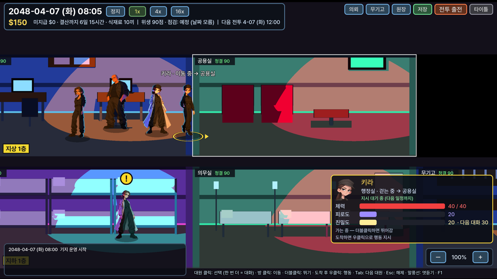
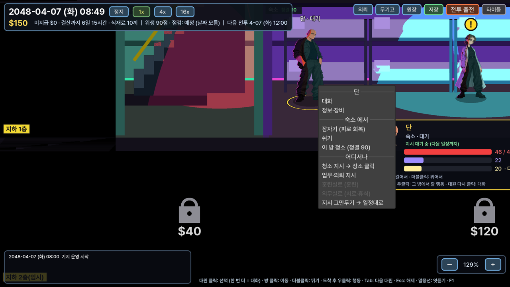


- **연구원 로한** (전투 안 함): 지하 1층 서쪽 끝 **연구실**에서 일함. **로한 클릭 → 무기 연구 창** — 연구 시작(달러, 시간, 선행 연구), 진행 막대, 로한이 연구실에 없거나 자면 멈춤.
  끝나면 그 무기를 **무기고에서 제작**(연구 전엔 '잠김 — 연구 필요'). 연구 목록은 엑셀 `outgame.xlsx` `연구` 시트, 새 무기 수치는 `balance.xlsx` `아이템` 시트.
  확인: `godot --path . ++ --scene=base --base_focus=npc_rohan --base_ui=research:res_shotgun:90` (연구 시작 + 90분 진행 후 창).

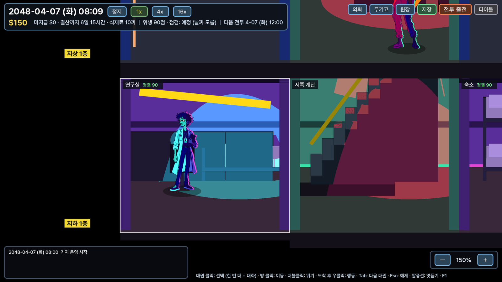
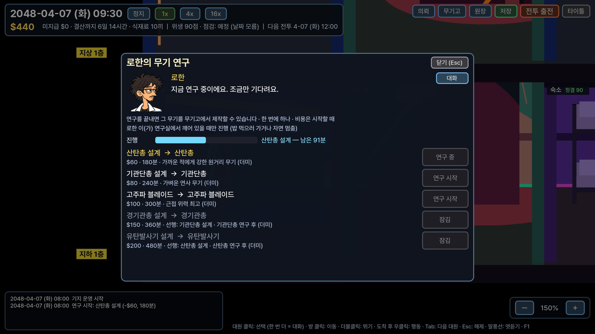
- **출정 대사 = Godot 에디터 상단 `출정 대사` 탭** — 아래 '출정 대기' 참고.
- **전투 발생 = Godot 에디터 상단 `전투 발생` 탭** (`data/outgame/battle_rules.json`): 규칙 추가·복제·삭제·순서, 방식(일정 간격 / 매일 정한 시각 / 한 번), 간격·기준 시각, 요일, 시작일, 스테이지(여럿이면 무작위), 넘기기 허용.
  아래에 게임 시작부터 7일 동안의 발생 시각 타임라인·다음 발생 목록·검사(형식 오류·없는 스테이지·7일 안에 발생 안 함). 저장(Ctrl/Cmd+S) → `기지 테스트 플레이`는 다음 전투 10분 전부터 새 기지 실행.


## 밸런스 데이터 (엑셀) · AI 에디터 · 스테이지 에디터
에디터는 Godot 에디터 플러그인(`addons/rtz_ai_editor`, `addons/rtz_stage_editor`, `addons/rtz_schedule_editor`, `addons/rtz_battle_editor`, `addons/rtz_sortie_editor`, `addons/rtz_skill_editor`, `addons/rtz_quest_editor`)으로, `./play.sh edit` (Windows `play.bat edit`) 로 에디터를 열면 상단 탭에 `AI` · `스테이지` · `일정` · `전투 발생` · `출정 대사` · `스킬 트리` · `퀘스트` 가 있습니다.
**밸런스 수치는 `data/balance.xlsx`** 한 파일에 시트별로 있습니다: `캐릭터` · `몬스터` · `아이템` · `스킬` · `스테이지` (+ 열 설명 `읽어보기`).
- 엑셀(또는 Numbers·LibreOffice)로 열어 고치고 **저장하면 1초 안에 게임이 다시 읽어 바로 적용** — 진행 중인 전투의 HP·AP·위력·이름까지.
  캐릭터 추가·편성·적 배치처럼 전투 구성이 바뀌는 것은 다음 전투(R 재시작)부터.
- 열 이름(1행)으로 찾으므로 열 순서는 바꿔도 되고, 행을 추가하면 새 캐릭터·몬스터·스킬·스테이지가 됩니다. 다른 시트에서 쓰는 이름은 `id` 열.
- 잘못된 참조(없는 무기·스킬 id 등)는 전투 중 알림과 콘솔 경고로 알려줍니다.

**AI 에디터** (Godot 에디터 상단 `AI` 탭 — 2D · 3D · Script 옆): 몬스터 AI 를 노드로 연결해 만듭니다 → `data/ai/<이름>.json`.
- 노드: 시작 / 조건(이번 턴 행동 수·AP·HP·우리 편 HP·상대 수·스킬 사용 가능·처치 가능·확률 → 예/아니오) / 스킬 사용(스킬·대상 고르기, 안 되면 '실패 시') / 턴 종료.
- 행동 하나마다 시작부터 다시 평가. 저장(버튼 또는 Ctrl/Cmd+S)하면 실행 중인 게임에도 바로 반영.
- 엑셀에서 스킬·몬스터를 바꿨으면 오른쪽 위 `엑셀 다시 읽기`.
- 어떤 몬스터가 어떤 AI 를 쓸지는 엑셀 `몬스터` 시트의 `AI` 열. 기본 제공: `default`(구울·슬라임), `aggressive`(늑대).

**스테이지 에디터** (Godot 에디터 상단 `스테이지` 탭): 스테이지별 적 배치를 칸에 놓아 만듭니다 → `data/stages/<스테이지 id>.json`.
- 왼쪽에서 몬스터를 고르고 칸 클릭 = 배치(2칸 몬스터는 두 칸), 배치된 몬스터 클릭/우클릭 = 제거, 저장 → `테스트 플레이`(에디터에서 그 스테이지로 전투 실행, F8 로 종료).
- 스테이지 목록·이름·조명·선공·적 HP/공격 배율·시드는 엑셀 `스테이지` 시트 (행 추가 = 새 스테이지). 메뉴의 `스테이지` 에서 골라 플레이.

## 전투 HUD 위치 편집 (Godot 에디터)
전투 HUD 의 배치는 `scenes/battle_hud.tscn` 에 노드로 저장돼 있어 에디터에서 직접 보고 옮길 수 있습니다.
1. `./play.sh edit` (Windows `play.bat edit`) 로 에디터를 열고, 파일 시스템 창에서 `scenes/battle_hud.tscn` 더블클릭.
2. 씬 트리에서 노드를 골라 화면에서 끌어 옮기거나, 인스펙터 **Layout → Transform/Anchors** 의 위치·크기(offset)를 고칩니다.
3. `Ctrl+S`(맥 `Cmd+S`) 저장 → 게임 실행하면 바로 반영.

| 노드 | 화면 요소 |
|---|---|
| `TopBar/TopRow/RoundLabel` | 좌상단 "라운드 N" |
| `Timeline` | 상단 중앙 행동 순서 초상화 줄 (초상화는 실행 중에 채워짐, 에디터에선 빈 상자) |
| `LogButton` / `LogPanel` | 우상단 전투 기록 아이콘 / 펼친 기록 창 |
| `PresetLabel` | 조명 프리셋 안내 글자 |
| `Bottom` (`BottomRow` 안: `PortraitFrame`, `Info`, `Spacer`, `EndTurnWrap/EndTurn`) | 하단 패널 전체·초상화·이름/수치·턴 종료 |
| `SlotsRow` | 하단 가운데 무기·자리 이동·스킬·필살기 슬롯 줄 (실행 중에 채워짐) |
| `StatusWindow` | 상태 이상 창 |
| `ResultBanner`, `Toast`, `DebugPanel` | 승패 글자, 알림, F1 디버그 창 |

- 컨테이너(`BottomRow`, `Info` 등) 안의 노드는 컨테이너가 자리를 정하므로 직접 끌 수 없습니다. 순서(씬 트리에서 위/아래로 끌기), 최소 크기(`custom_minimum_size`),
  간격(Theme Overrides → Constants → separation)으로 조정합니다.
- 슬롯 하나하나의 크기(스킬 75px, 무기 44×112 등)·색은 `scripts/ui/battle_hud.gd` 상단 상수(`SLOT`, `WEAPON_W` …)에서 바꿉니다.
- `godot --headless --path . ++ --export_hud=1` 은 코드 기본값으로 `battle_hud.tscn` 을 **다시 만들어 편집한 배치를 덮어씁니다** (처음 생성용).
- 맥에서 배치를 고친 뒤 `git pull` 을 하면 충돌할 수 있으니, 고친 `battle_hud.tscn` 은 커밋하거나 알려 주세요.

## 카메라 각도 조절 (인스펙터)
에디터에서 `scenes/battle_2d.tscn` 을 열고 `View` 노드를 선택 → 인스펙터 **카메라** 그룹:
`Cam Pitch Deg`(내려다보는 각도) · `Cam Distance`(거리) · `Cam Fov Deg`(화각) · `Cam Target`(바라보는 바닥 위 점) · `Cam Screen Center`(그 점이 놓이는 화면 위치).
저장 후 실행하면 캐릭터 위치·크기, 3D 배경, 조명, 그림자가 그 구도로 맞춰집니다. 게임 실행 중에는 씬 트리의 **원격(Remote)** 탭 → `Battle2D/View` 를 골라 값을 바꾸면 즉시 반영.
(캐릭터 원화 자체는 평면 그림이라 각도를 바꿔도 그림이 다시 그려지지는 않습니다.)

아트 규격(아이콘·초상화·UI): `docs/ui_art_spec.md`

## 실행
1. 위 설치 스크립트를 썼다면 `play.bat` / `play.sh`. 직접 설치한 Godot 4.7 (stable) 로 이 폴더를 열어 F5 해도 됩니다. 메인 씬 `scenes/title.tscn` (타이틀).
2. 타이틀 `게임 시작` → 기지 (위 '게임 루프' 참고). 전투만 따로 보려면 타이틀 `전투 테스트 메뉴 (개발용)`: 조명 프리셋(G1~G4), 선공(동전/아군 기습/적 매복), 시드를 고른 뒤 편성 → 전투 (기지 성장 반영 없음).
3. 화면: 창은 **QHD(2560×1440 픽셀)** 로 고정해 그 해상도로 렌더합니다(모니터가 작으면 16:9 로 맞춰 줄임). `F11` 전체 화면.
4. 전투 시작: 일반 전투(동전)는 화면 아래에서 금화가 튀어 올라 오른쪽으로 돌며 떨어집니다 — **고양이 면(앞면) = 아군 선공, 매끈한 면(뒷면) = 적 선공**.
   착지 후 "아군 선공"/"적 선공" 글자가 잠깐 뜹니다.
   상단 중앙에 행동 순서가 초상화로 나오고(마우스를 올리면 이름), 차례인 캐릭터의 초상화가 30% 커집니다.
   전투 기록은 우측 상단 아이콘만 보이다가 아이콘 클릭(또는 `L`)으로 기록 창을 펼칩니다. 글꼴은 Pretendard.
5. 전투 중 단축키: `1~4` 조명 프리셋 즉시 교체 · `L` 전투 기록 펼치기 · `F1` 디버그 패널 · `F2` HUD 숨김 · `F3` 캐릭터 림 라인 켜기/끄기 · `R` 재시작 · `Space` 턴 종료 · 우클릭 취소.

렌더러는 `gl_compatibility` 로 두었습니다(저사양/소프트웨어 렌더 검증 포함). Forward+ 로 바꿔도 셰이더는 그대로 동작합니다.

## 카메라 (2D 전투)
2D 전투는 정면 평면이 아니라 **뒤로 물러나 40° 내려다보는 가상 카메라**로 구성됩니다. `tools/gen_sprites.py` 의 `CAMERA`
(피치 40°, 거리 15m, 세로 화각 32°, 화면 중심 y 480 — 벽이 더 보이고 바닥이 덜 보이게 구도를 위로)로 배경(바닥 원근·벽·소품·빛 영역 마스크)을 그리고, 같은 값이
`manifest.json` 의 `camera` 로 저장되어 `BattleView2D` 가 슬롯 위치와 캐릭터 크기(원근 배율)를 계산합니다.
각도나 거리를 바꾸려면 `CAMERA` 를 수정하고 `python3 tools/gen_sprites.py` 를 다시 실행하면 배경과 배치가 함께 바뀝니다.
배경 3D 방도 같은 각도(40°)로 맞춰 그립니다.

## 레벨 · 스킬 (액티브 · 패시브 · 신앙)
전투에 나간 대원은 **경험치**(승리 100 · 패배 40)를 받고, 레벨이 오를 때마다 **스킬 포인트 +1** (처음 1).
기지 위 **`스킬` 버튼**(또는 대원 우클릭 → 스킬 트리, 정보·장비 창)으로 **스킬 창**을 엽니다.
- **왼쪽 = 대원 목록** (초상화·레벨·남은 포인트, 위아래 스크롤 — 대원이 늘어나도 그대로). 누르면 그 대원으로 바뀜.
- **위 탭 = 스킬 종류 세 가지**
  - **액티브 스킬**: 전투에서 쓰는 스킬을 강화(강공격·기본 공격·필살기 위력 등)하고, **갈래 끝(3단계)에서 새 스킬**(강타·측면 기습·재정비·고무, 앨마는 강화만 — 기본 스킬 칸 3개가 이미 참).
  - **패시브 스킬**: 늘 적용되는 능력치(최대 HP·속도·AP·AP 회복·방어·모든 공격 위력·회복량).
  - **신앙 스킬**: 믿는 신에 따라 배울 수 있는 스킬이 다름 (아래).
- 액티브·패시브는 각각 **십자형 트리**: 가운데(처음부터) → **북 = 화력 · 동 = 기동 · 남 = 생존 · 서 = 전술** 네 갈래로 1~4단계(지금 데이터는 3단계). 어느 방향으로 뻗느냐가 빌드.
  스킬 포인트는 두 트리가 **같이 씀**. 갈래 안에서는 앞 단계부터, **갈래 끝(마지막 단계)은 트리마다 하나만**.
- **레벨이 모자란 스킬은 회색 + 가운데 붉은 "경험 부족"**. 노드를 누르면 왼쪽에 설명·필요 레벨, `배우기`. `액티브/패시브 초기화` = 그 트리 포인트 돌려받기 (지금은 무료).
- 효과는 기지에서 출전한 전투에 반영. 레벨도 피해·회복에 반영(레벨/2).
- **스킬 노드는 직접 짬 = Godot 에디터 상단 `스킬 트리` 탭** (`data/skill_tree.json`):
  캐릭터·액티브/패시브 트리를 고르면 게임과 같은 십자형 그림. **노드를 누르면 오른쪽에서 이름·필요 레벨·효과·값·설명**을 고치고, **갈래 끝의 `+` 칸을 누르면 단계 추가**(갈래마다 최대 4단계, 갈래 길이는 제각각 가능).
  효과 = 최대 HP · 속도 · 최대 AP · AP 회복 · 방어 · 모든 공격 위력 · 모든 회복량 · **스킬 강화**(고른 스킬 위력·회복·AP 지급 +) · **새 스킬**(스킬 시트에서 고름). 설명은 `설명 자동 채우기` (효과·값을 바꾸면 같이 바뀜).
  `한 단계 안쪽/바깥으로`(자리 바꾸기) · `이 노드 삭제`(바깥 단계는 당겨짐) · `다른 캐릭터 트리 가져오기` · `필요 레벨 자동`(시작 +0/+2/+4…) · `트리 비우기`.
  아래 **검사**: 겹친 id · 빈 단계 · 없는 스킬(오류) / 필요 레벨 역전 · 새 스킬이 기본 스킬 칸(3칸)을 넘을 수 있음(주의). 저장(Ctrl/Cmd+S) → 게임 실행 중이면 바로 반영. `기지 스킬 창 테스트 플레이` = 그 대원을 정한 레벨로 올려 기지 스킬 창.
- 새 스킬 자체(AP·위력 등)는 밸런스 엑셀 `스킬` 시트. 경험치·레벨 수치는 기지 엑셀 `설정`(xp_win, xp_lose, xp_level_base, xp_level_step, level_max).
- 전투 결과 화면에 출전 대원 경험치·레벨 업 표시.
- 확인: `godot --path . ++ --scene=base --base_ui=skills:a_dan:2500:dan_a_n1,dan_a_n2,dan_a_n3::active` (경험치 주고 배운 상태로 창, 셋째 칸 `L9` = 레벨 9 까지, 마지막 칸 active / passive / faith).

- **신앙 스킬**: 캐릭터마다 **믿는 신**이 있고, **신에 따라 배울 수 있는 신앙 스킬이 다름**. 신앙도(0~100)가 필요치 이상이면 포인트 없이 배움, 모자라면 회색 + 붉은 "신앙 부족". 출전할 때마다 신앙도 +5. 아래에 다른 신들의 스킬(배울 수 없음)도 표시.
  **신·신앙 스킬 = Godot 에디터 `스킬 트리` 탭 → `신앙 스킬`** (`data/faith.json`): 왼쪽 신 목록(추가·삭제, id·이름·상징색·설명, 믿는 대원 표시) · 가운데 그 신의 신앙 스킬(필요 신앙도 순, 추가·삭제) · 오른쪽 id·이름·필요 신앙도·효과·값·설명(자동 채우기) · 아래 검사.
  **누가 어느 신을 믿는지·시작 신앙도도 같은 화면 아래 `대원 신앙`** (대원마다 믿는 신 고르기 — 무신앙 포함 · 시작 신앙도, `data/faith.json` 의 `believers`). 엑셀 캐릭터 시트의 `신`·`신앙` 열은 없앰.
  신마다 **아이콘 글자**(비우면 이름 끝 단어 첫 글자: 솔·베·녹·테) — 게임에서 상징색 원 아이콘. 신 id 를 바꾸거나 지우면 믿는 대원도 따라감(지우면 무신앙). **지금 값은 임시** (태양신 솔루스·전쟁신 베이라·밤의 여신 녹트·대지모 테라, 각 4개).
  게임 스킬 창 신앙 탭·대원 정보 카드의 **신 아이콘을 누르면 세계관 도감 `종교(신)` 탭**의 그 신.
- **신 해금 캐릭터 → 기적**: 정체가 신인 캐릭터가 있음. **해금되면 그 캐릭터의 스킬 창 신앙 탭이 `✦ 기적`** 으로 바뀜 — 정체인 신(아이콘 → 도감), 신앙도 대신 **의지**(해금될 때 `시작 의지`, 출전마다 + 기지 설정 `will_battle`(기본 5) — 신앙도를 올려도 기적에는 안 씀), 그 캐릭터만의 **기적**(필요 의지 이상이면 포인트 없이 배움, 모자라면 회색 + '의지 부족'). 전에 배운 신앙 스킬 효과는 그대로. 대원 목록·도감에 ✦, 도감 등장인물에 '정체' 표시(잠긴 동안은 안 보임).
  **에디터 `스킬 트리` 탭 → `기적 (신 해금)`** (`data/faith.json` 의 `divine` · `miracles`): 왼쪽 대원 목록에서 고르고 **`이 캐릭터는 정체가 신`** 을 켜면 신 해금 캐릭터 → 정체인 신 · **`이미 해금됨 (처음부터 신)`** 체크 · 체크 안 하면 **해금 조건**(직접 해금 = 이벤트·대사 / **미션 완료** = 고른 의뢰 업무를 끝냄·고른 전투 승리·고른 연구 완료·고른 **퀘스트** 완료 / 레벨 / 신앙도 / 친밀도 / n일차 + 값) · "새 게임: 잠김 → …" 확인 줄. 가운데 그 캐릭터의 기적(추가·삭제), + **시작 의지**. 오른쪽 기적 id·이름·필요 의지·효과·값·설명. 테스트 플레이 = 정체 해금 + 의지 100 으로 기적 탭.
  게임에서 상태 확인: `BaseSim.divine_state(캐릭터)` = `""`(신 아님) / `"locked"` / `"unlocked"`, 직접 해금 `BaseSim.unlock_divine(캐릭터)`. 조건은 미션(의뢰·전투·연구·퀘스트)을 끝낼 때·레벨·신앙도·친밀도가 바뀔 때·날이 바뀔 때·불러온 뒤 검사 → 해금되면 기록·알림. 미션 완료 확인 `BaseSim.quest_done("quest:q_hana_secret")`. 확인: `--base_ui=divine:a_hana:30` (셋째 칸 = 더할 의지).
  **하나 = 신 (잠김)** — 미션 완료로 해금. **[임시]** 정체 = 대지모 테라, 미션 = **퀘스트 '하나의 비밀'** 완료(아래 '퀘스트'), 시작 의지 10, 기적 3개 (대지의 맥박 의지 20 · 흔들리지 않는 자 40 · 대지모의 현신 70). 니키타는 신 아님.
  확인: `godot --path . ++ --scene=base --base_ui=faith:a_dan:15:veyra_1`

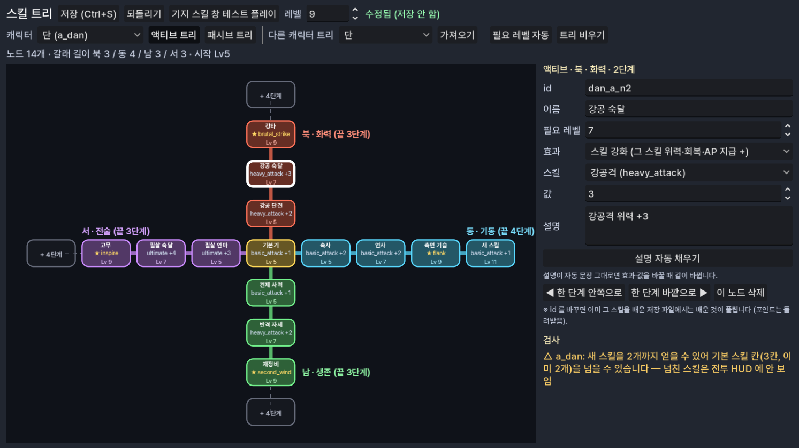
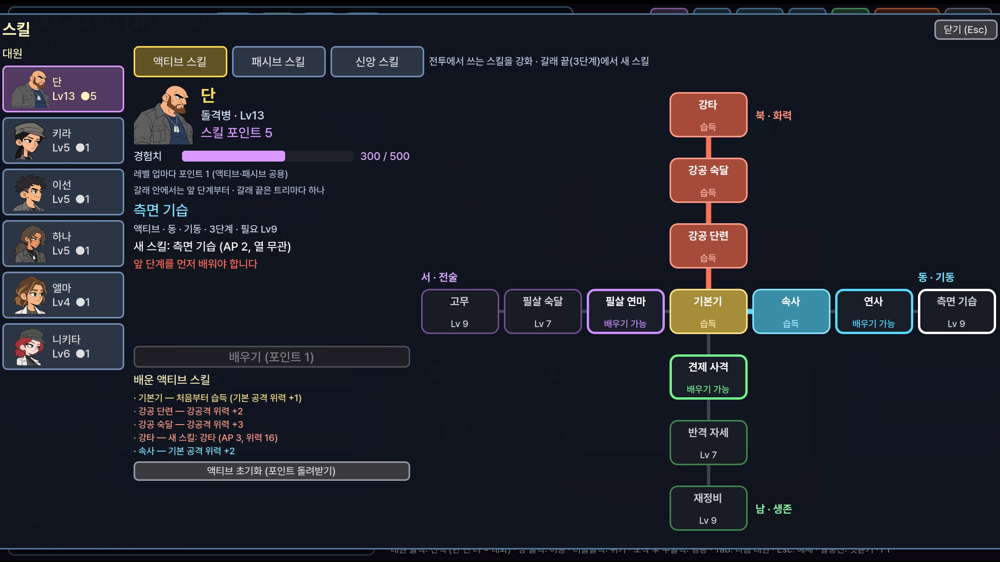
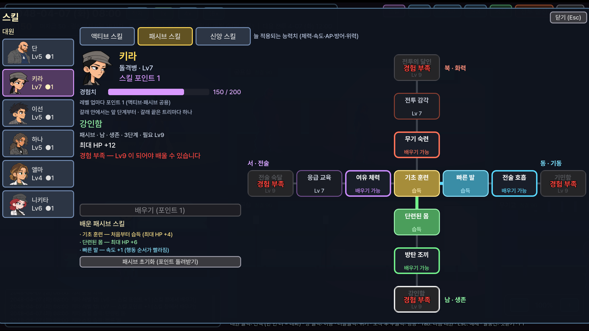
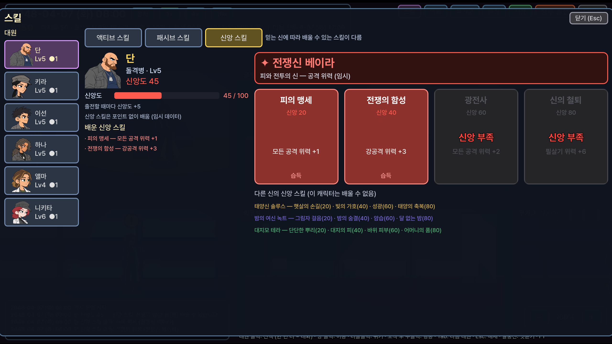
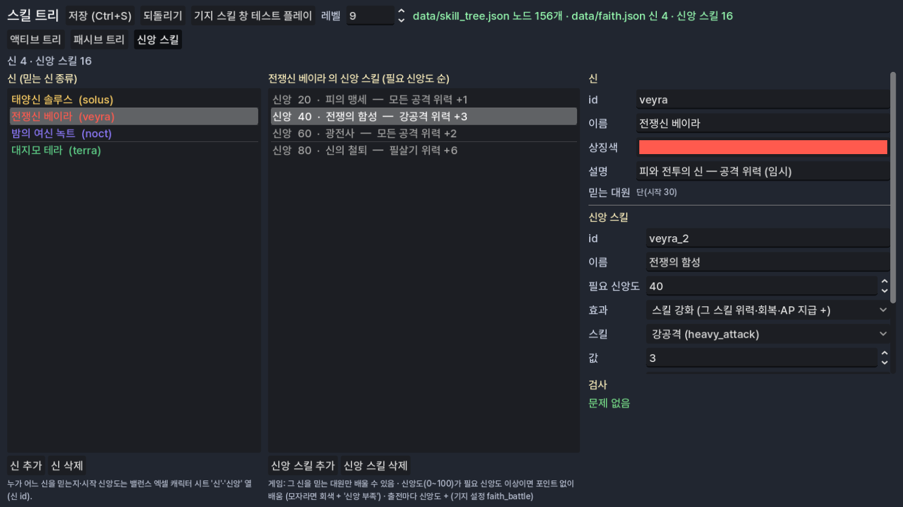
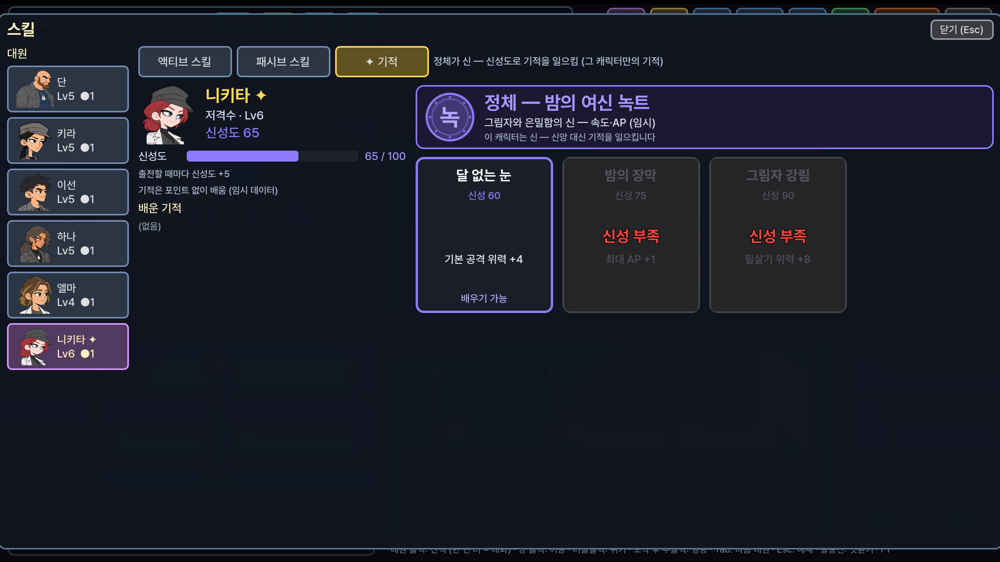
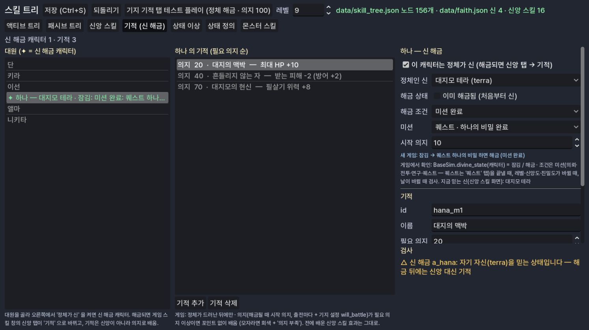

## 퀘스트 (에디터)
- 게임: 기지 상단 **`퀘스트`** 버튼 → 퀘스트 창 (진행 중 → 완료, 시작 안 한 퀘스트는 안 보임). 카드마다 의뢰인 얼굴 · 설명 · 단계(✓ 끝냄 / ▶ 지금 + 진행 횟수 / 뒤 단계는 `???`) · 보상. 시작·다음 단계·완료 때 알림, 기지 기록에 `◆`.
- 규칙(`BaseSim`): **시작 조건**을 채우면 자동 시작 (처음부터 / 직접 시작 = 이벤트·대사에서 `BaseSim.start_quest(id)` / 미션 완료 후(의뢰·전투·연구·다른 퀘스트) / 의뢰인 레벨·신앙도·친밀도 / n일차) → **단계를 앞에서부터 하나씩** → 마지막 단계를 끝내면 완료 + **보상**(현금은 주간 결산 때, 친밀도는 의뢰인).
  단계 종류: 의뢰 완료 · 전투 승리(스테이지 또는 아무 전투) · 대원과 대화 · 연구 완료 · 대원 친밀도 · 대원 레벨 · 일차 도달 · 다른 퀘스트 완료. **횟수 단계(의뢰·전투·대화)는 그 단계가 시작된 뒤부터 셈** — 전에 한 것은 안 셈.
  완료한 퀘스트는 **신 해금 조건 `미션 완료 → 퀘스트`** 로 씀 (`quest:퀘스트 id`). 저장 파일에 진행 단계·대화 횟수 저장.
- **에디터 = Godot 에디터 상단 `퀘스트` 탭** (`addons/rtz_quest_editor` → `data/quests.json`):
  왼쪽 퀘스트 목록(추가 · 복제 · 삭제 · ↑↓ 순서, ✦ = 신 해금에 쓰임) · 가운데 id(바꾸면 다른 퀘스트·신 해금 조건도 따라감) · 이름 · 의뢰인 · 설명 · 시작 조건 · **단계 카드**(종류 · 대상 · 횟수/값 · 표시 글 — 비우면 자동 설명, ↑↓ · 삭제) · 보상(현금 · 의뢰인 친밀도).
  오른쪽 **게임 퀘스트 창 미리보기** · 연결(이 퀘스트로 해금되는 신 · 이 퀘스트를 쓰는 퀘스트 · **`이 퀘스트로 신 해금`** = 신 해금 캐릭터의 해금 조건을 이 퀘스트 완료로 → `faith.json`) · 검사(없는 대상 · 중복 id · 의뢰인 없는 조건 등).
  **`기지 테스트 플레이`** = 저장 → 새 기지에서 그 퀘스트를 시작(`시작 단계` 까지 건너뛰기)하고 퀘스트 창. 저장하면 게임 실행 중에도 다시 읽음.
- **[임시] 퀘스트 2개**: `하나의 비밀`(처음부터 · 의뢰인 하나 — 민간인 호위 의뢰 완료 → 전투 승리 → 하나와 대화, 보상 $60 · 친밀도 +10 · **하나의 정체(신) 해금**) / `로한의 첫 연구`(2일차부터 — 산탄총 설계 연구 → 로한과 대화, $40 · +5).
- 확인: `godot --path . ++ --scene=base --base_ui=quest:q_hana_secret:1` (그 퀘스트 시작, 셋째 칸 = 그 단계(0부터)까지 건너뛰기).

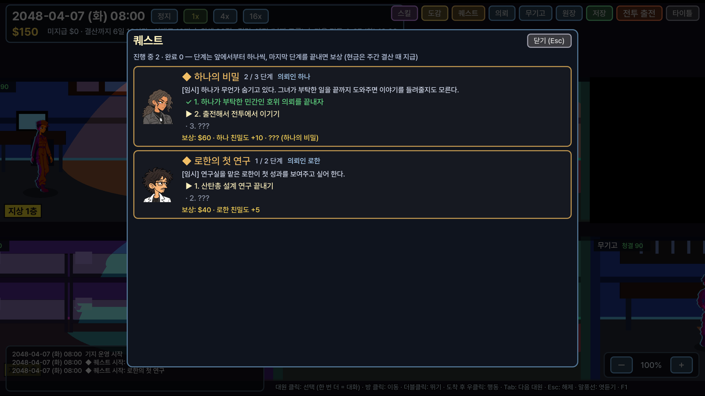
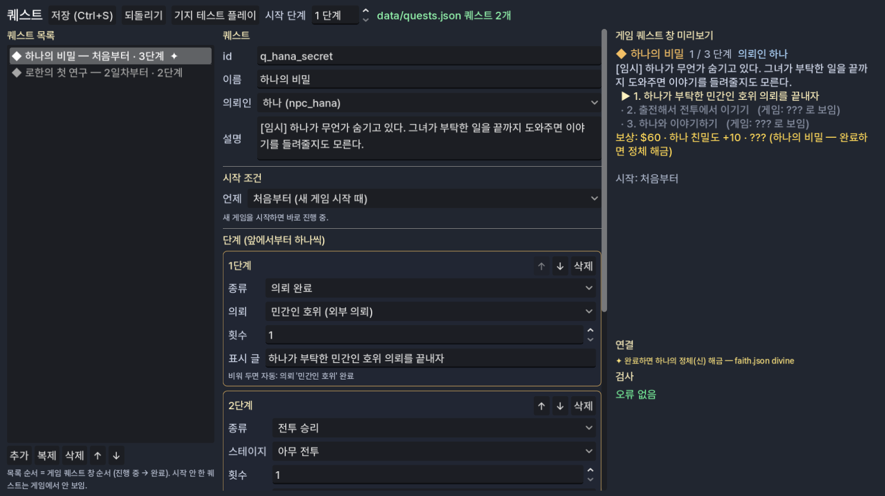

## 세계관 도감
기지 상단 **`도감`** 버튼 (또는 신 아이콘 클릭). 탭 = **등장인물 · 몬스터 · 상태이상 · 종교(신) · 도시 배경**. 왼쪽 목록(위아래 스크롤) → 오른쪽 그림·이름·부제·설명 + 게임 기록.
- 등장인물: 아군 + 전투에 안 나가는 대원(로한) — 병과·레벨·키·HP·속도·AP·방어·사거리, **믿는 신 아이콘(누르면 그 신)**.
- 몬스터: 레벨·HP·속도·AP·방어·차지 칸·쓰는 기술. 상태이상: 효과(긍정/부정)·규칙·그 상태를 거는 기술. 종교(신): 설명·**믿는 대원(누르면 그 대원)**·신앙 스킬. 도시 배경: 설명만.
- **데이터 = `data/codex.json`** — 탭마다 `{id, title, subtitle, body}` (등장인물 `sprite`, 도시 `color`). 등장인물·몬스터·상태이상·신은 게임 데이터(엑셀·statuses.json·faith.json)에 있는 것이 자동으로 들어가고 이 파일은 설명·부제·순서만 덧붙임 (제목을 비우면 게임 이름, 설명이 없으면 "기록 없음"). 도시 배경은 이 파일에만.
- **지금 설명은 모두 임의로 넣은 `[임시]`** (도시: 헤이븐 기지 · 잿빛 항구 애시포트 · 옛 수도 칼드라 · 하층 구역).
- 확인: `--scene=base --base_ui=codex:gods:solus` (탭: characters · monsters · statuses · gods · cities).

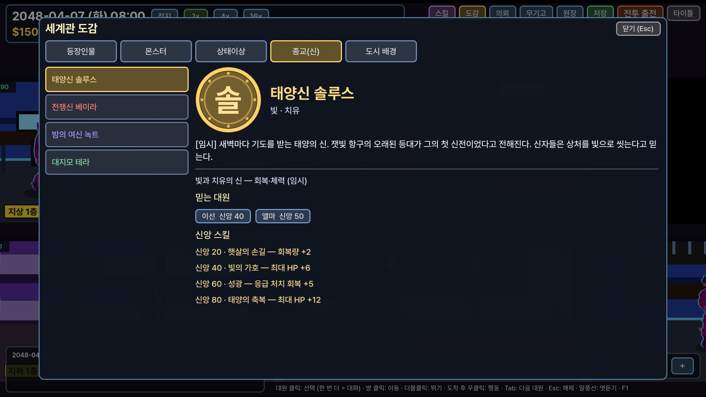
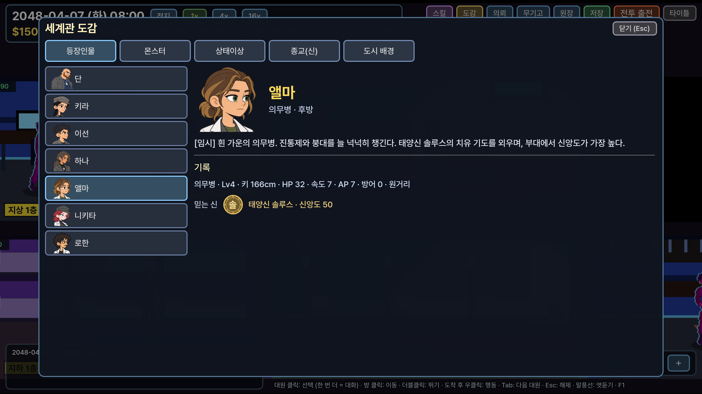
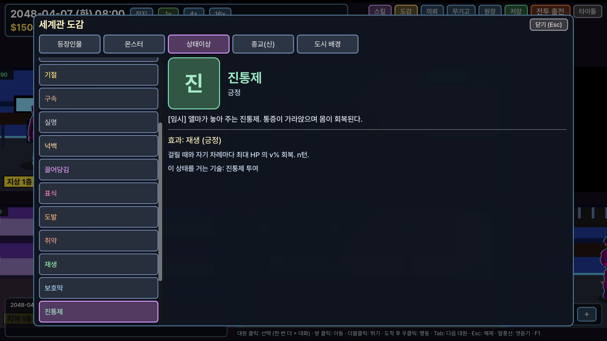
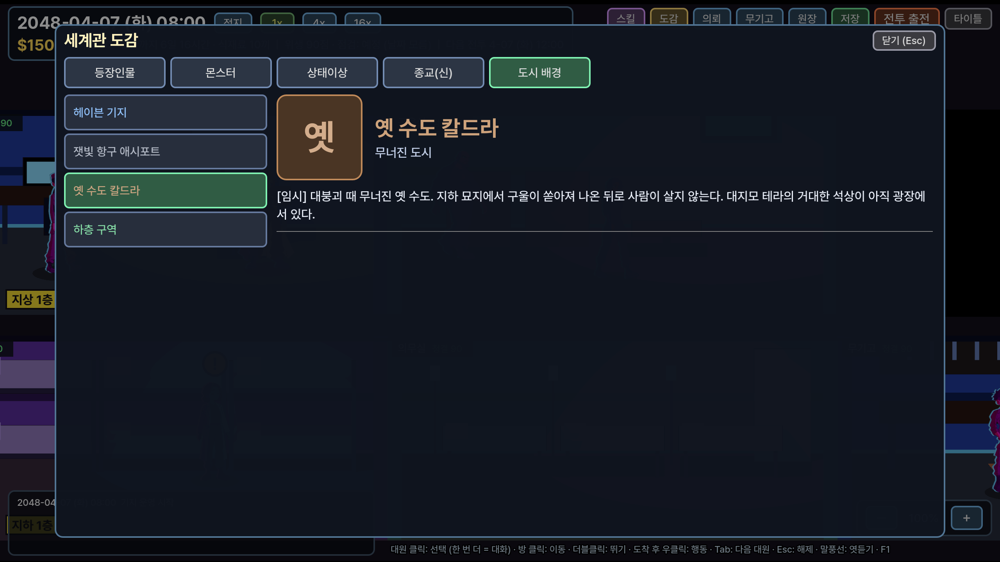

## 전투 상태 이상
**상태 = 이름 + 효과(규칙)**. 같은 효과를 이름만 다르게 여러 상태로 씁니다 — 예: 앨마 `진통제 투여` → 상태 `진통제`(`regen_2`), 하나 `자가 치유` → 상태 `자가 치유`(`regen_3`), 둘 다 효과 **재생**(`regen`).
**상태 id = 효과 id, 같은 효과의 두 번째부터 `_2`, `_3` …** (자동). **같은 id 는 겹치지 않음** — 다시 걸리면 하나로 남고 남은 턴·수치 큰 쪽으로 갱신. id 가 다르면 같은 효과라도 따로 걸려 둘 다 적용.
- **상태 정의 = 에디터 `스킬 트리` 탭 → `상태 정의`** (`data/statuses.json`): 상태마다 id(자동) · 이름 · **효과** · 머리 위 글자 · 색 · 설명(비우면 효과 설명). `새 상태 — 효과` 고르고 `+ 추가`(id = 그 효과의 다음 번호), `삭제`(달린 스킬에서도 뺌). 효과를 바꾸면 id 도 새 효과 번호로 바뀌고 달린 스킬도 따라감. 오른쪽 아래에 그 상태가 달린 스킬 목록(`열기`). 검사: id 가 `효과` 또는 `효과_숫자(2 이상)` 가 아니면 오류.
- **스킬에 다는 곳 = `상태 이상`** (`data/skill_status.json`): 스킬에는 상태(id)를 답니다. 수치의 뜻은 효과마다(출혈 = 최대 HP %, 넉백 = 칸 수 …).
- 게임 규칙은 효과로만 판단 (`StatusCatalog.effect_of`) → 이름을 바꾸거나 같은 효과의 새 상태를 만들어도 규칙이 그대로 적용.

스킬에 상태 이상을 달면 맞은 대상에게 확률로 걸립니다:
왼쪽 스킬 목록(전체 / 상태 이상 달린 것 / 아군이 쓰는 것 / 괴물이 쓰는 것, 달린 상태 표시) → 오른쪽에서 `+ 상태 이상 추가`, 상태·턴·수치(효과마다 뜻 표시)·확률, `빼기`. **한 스킬에 여러 개**(각각 따로 확률). 가운데에 상태 설명(이름 → 효과), 아래 검사.
`전투 테스트 플레이` = 고른 스킬을 아군 모두의 첫 스킬 칸에 넣고 첫 스테이지 전투. 스킬 자체(AP·위력·대상)는 여전히 밸런스 엑셀 `스킬` 시트.
**적용 시점**: 처음 걸릴 때 바로 한 번 + 그 캐릭터 차례가 올 때마다 **행동보다 먼저**. **n턴 = 그 캐릭터 차례 n번** (차례가 끝날 때 1 줄고 0 이면 풀림). 다시 걸리면 남은 턴·수치 중 큰 쪽.

| 상태 | 효과 (n = 상태턴, v = 상태수치) |
|---|---|
| 출혈 | 걸릴 때·차례마다 최대 HP 의 v% 피해, n턴 |
| 화상 | 걸릴 때·차례마다 **화염 속성 고정 피해** v (방어 무시), n턴 |
| 동상 | 차례 n번 뒤(그 차례 시작에) 최대 HP 의 v% 피해 1회, 그리고 풀림 |
| 감속 / 가속 | 속도 v% 감소 / 증가 → 행동 순서 (걸리면 그 라운드 남은 순서부터 다시 정렬), n턴 |
| 기절 | n턴 동안 자기 차례에 행동 불가 (AP 는 회복). **다른 아군이 자기 차례에 기절한 캐릭터와 자리를 바꾸는 것은 가능** |
| 구속 | n턴 동안 자리 이동 불가, **다른 캐릭터와 자리 교환도 불가** |
| 실명 | n턴 동안 고른 대상 대신 무작위 — 아군 대상 스킬은 아군 중 1명, 적 대상 스킬은 적 중 1명 (사거리 규칙 안에서) |
| 넉백 | 맞으면 v칸 **뒤로** 밀림 (그 칸에 같은 편이 있으면 자리를 바꿈). 맨 뒤 열·구속·부상·큰 몸집이면 안 밀림. 턴 없음(상태로 안 남음) |
| 끌어당김 | 맞으면 v칸 **앞으로** 끌려옴 (같은 편과 자리 바꿈). 맨 앞 열·구속·부상·큰 몸집이면 안 됨. 턴 없음 |
| 표식 | n턴 동안 이 대상을 노리는 공격의 위력 v% 증가(방어 빼기 전). **적 AI 는 표식이 있는 대상을 먼저 노림** (그중에서 AI 규칙대로) |
| 도발 | n턴 동안 **상대 편은 공격할 때 이 캐릭터만** 고를 수 있음 — 그 공격이 닿을 때만 (근접은 닿는 열에 있을 때). 보통 자신에게 거는 긍정 상태 |
| 취약 | n턴 동안 받는 피해 v% 증가 (출혈·화상 같은 상태 이상 피해 포함) |
| 재생 | 걸릴 때·차례마다 최대 HP 의 v% 회복 (최대 HP 까지), n턴 |
| 보호막 | 받는 피해를 v만큼 대신 막고, 다 막으면 사라짐 (상태 이상 피해 포함, 취약 반영 뒤). 최대 n턴. 상태 칸에 남은 양 표시 |

- 화면: 머리 위 배지(한 글자 + 남은 턴: `혈2`, `기1`, 동상은 터지기까지 남은 차례), 하단 상태 칸에 이름·남은 턴(마우스를 올리면 설명), 피해 숫자에 상태 이름, 걸릴 때 `출혈!`. 스킬 칸 설명에도 상태 이상 표시.
- 전투가 끝나면 전투 상태 이상은 사라짐 (기지로 넘어가는 건 부상 등 기지 상태만).
- [임시] 스킬: 강타 = 기절 1턴 50% · 측면 기습 = 출혈 2턴 10% · 고무 = 가속 2턴 30% · 소이탄(하나 액티브 북 끝) = 화상 2턴 4 · 제압 사격(이선 액티브 동 끝) = 감속 2턴 30%.
  진통제 투여(`painkiller_shot`, 지원 AP 2, 아군 1명) = 진통제(`regen_2`) 3턴 8% · 자가 치유(`self_heal`, 지원 AP 1, 자신) = 자가 치유(`regen_3`) 3턴 6% — 엑셀 스킬 시트에 추가, **아직 아무 캐릭터에게도 안 줌** (스킬 트리 에디터에서 노드로 넣기). 넉백·끌어당김·표식·도발·취약·보호막은 아직 단 스킬 없음.
  괴물(몬스터 스킬 탭에서 고침): 구울 할퀴기 = 출혈 2턴 8% · 무덤의 냉기 = 동상 2턴 20% / 늑대 발목 물기 = 구속 2턴 · 모래 차기 = 실명 1턴 70%. AI 그래프에 '그 스킬의 상태 이상이 없는 대상' 규칙 추가 (필살기 다음에 상태 이상 스킬, 다 걸려 있으면 강공격).
- 확인: `godot --path . ++ --scene=battle --battle_status=a_dan:bleed:2:10;wolf:frost:2:20` (캐릭터 id 또는 스프라이트:상태:턴:수치).

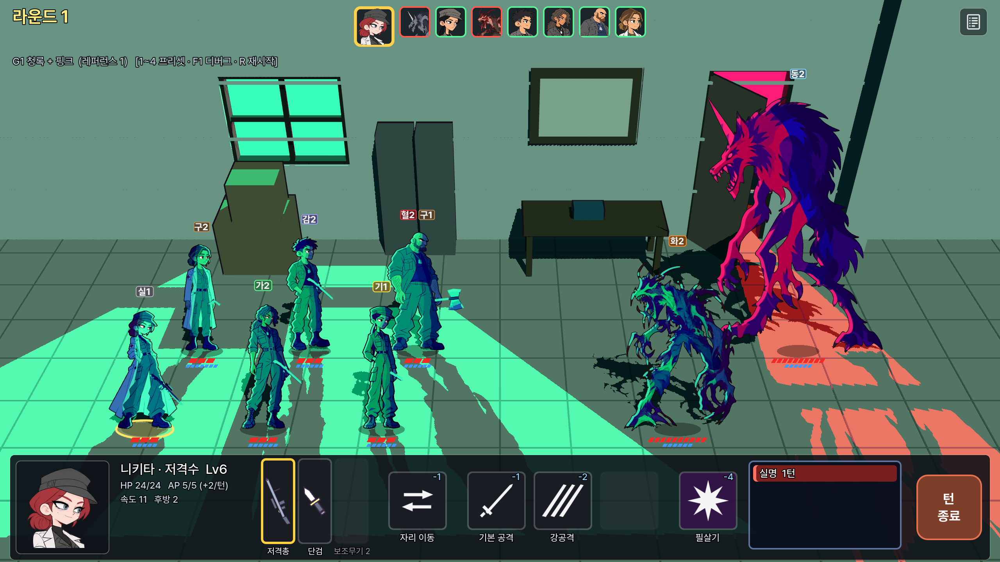

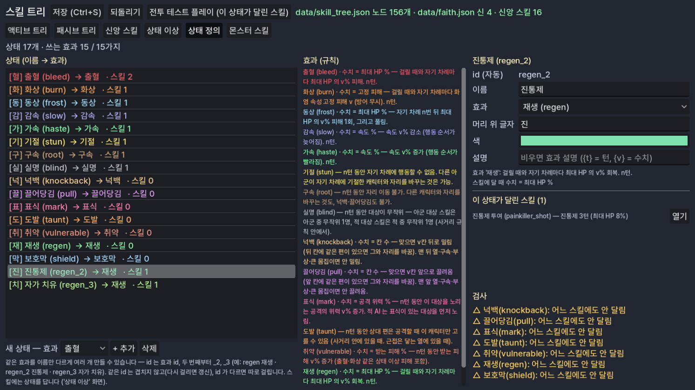
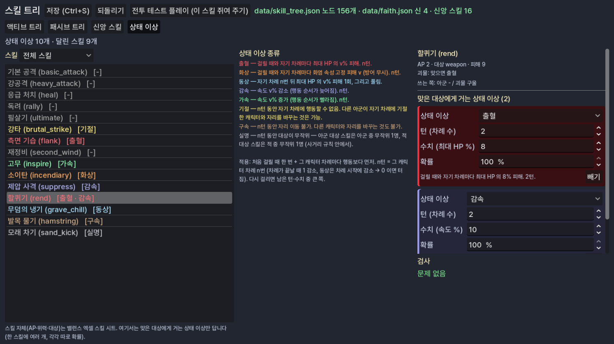

## 몬스터 스킬 (에디터)
**Godot 에디터 `스킬 트리` 탭 → `몬스터 스킬`** (`data/monster_skills.json`):
- 왼쪽 **몬스터 목록** → 가운데 **그 몬스터가 쓰는 스킬**(순서대로, `넣기`·`빼기`·`▲▼`). 공용 스킬(기본 공격·강공격·필살기 = 엑셀 스킬 시트)도 넣을 수 있음.
- `+ 새 몬스터 스킬` → 오른쪽에서 id·이름·종류(공격/강공격류/지원/필살기)·AP·대상·효과(피해/회복/AP 부여/상태 이상만)·위력·설명, 그 아래 **상태 이상 카드**(바로 달기). `이 몬스터 스킬 삭제` = 모든 몬스터에서.
- **AI**: AI 그래프가 안 쓰는 스킬은 목록에 `⚠ AI 안 씀` → **`AI 그래프에 넣기`** = 그 몬스터 AI 그래프의 필살기 다음 칸에 '스킬 사용' 노드를 끼움 (상태 이상이 있으면 대상 규칙 '그 상태 이상이 없는 대상', 실패하면 다음으로). 세부 조정은 `AI` 탭.
- 검사(엑셀 스킬과 겹친 id · 없는 스킬 · 대상/효과 어긋남 · 아무도 안 쓰는 스킬 · AI 안 씀) · `전투 테스트 플레이` = 첫 스테이지 전투. 몬스터 스탯(HP·속도·AI 이름)은 엑셀 몬스터 시트.

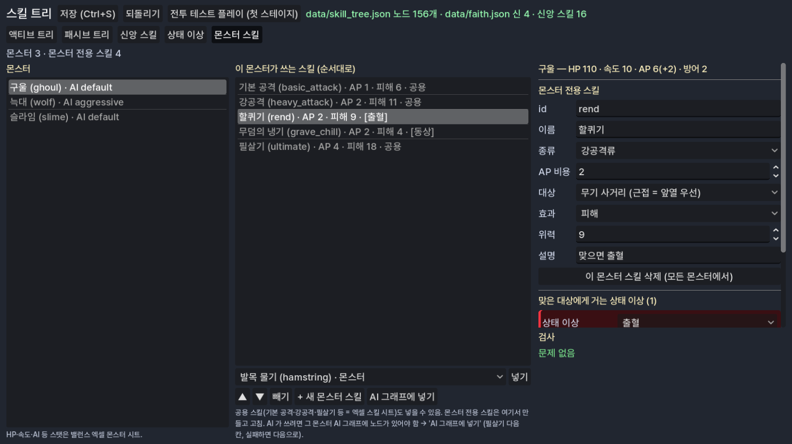

## 출정 대기 (편성 화면)
기지에서 전투가 발생해 `전투 배치로` 를 누르면 출정 대기 화면이 뜹니다.
- 왼쪽 **출정 가능 대원 목록**: 초상화 · 체력/피로/친밀도 막대 · 상태 이상(부상 등) · 배치 위치. 기지에서 외부 의뢰 중인 대원은 흐리게 '외부 의뢰 중' (출정 불가).
- 오른쪽 위 **진형**: 후방 2 · 중간 2 · 전방 2 (오른쪽이 적). 대원 카드를 **끌어다 칸에 놓기** · 진형끼리 끌면 이동/자리 교환 · 목록에서 끌어 찬 칸에 놓으면 교체 · 목록으로 끌거나 **우클릭하면 빼기**. 클릭(대원 → 칸)도 됨. 1~6명 출정.
- 배치된 대원은 **초상화 위 말풍선**으로 지금 상태에 맞는 한마디 (화면을 열 때, 놓을 때).
- 아래: 배치 수 · **출정(전투 시작)** · 기본 편성 · 모두 빼기 · 기지로.

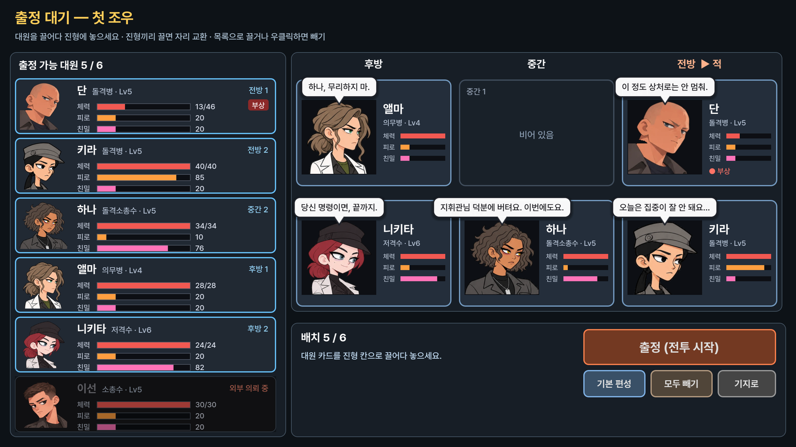
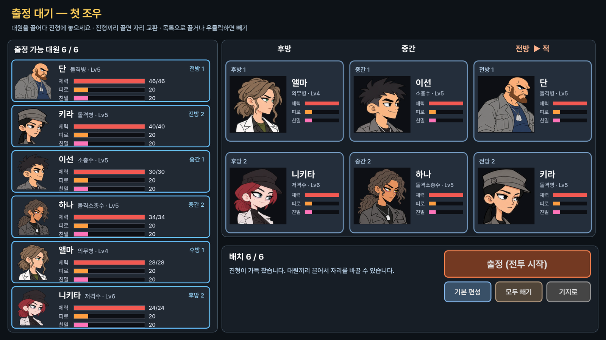

**말풍선 대사 = Godot 에디터 상단 `출정 대사` 탭** (`data/outgame/sortie_lines.json`):
- 대사마다 누가(공통/대원) · 문장(`{name}` 이름, `{with}` 함께 출정 대원) · 우선순위 · 조건(친밀도·피로도·체력 % 범위, 상태 이상, 자리, 함께 출정하는 대원).
- 고르는 법: 조건이 다 맞는 대사 중 **우선순위 높은 것 → 같으면 대원 전용이 공통보다 먼저 → 무작위**.
- 오른쪽에 말풍선 미리보기(게임과 같은 폭), 아래에 **상황 시험**(대원·친밀도·피로·체력·상태·자리·함께 출정을 바꾸면 그때 나올 대사와 밀린 대사 목록), **검사**(빈 대사·최소>최대·없는 대원·너무 긴 대사·대사가 하나도 없는 상황).
- `출정 대기 테스트 플레이` = 저장 → 새 기지에서 출정 대기 화면 (키라 피로 85, 단 부상, 니키타·하나 친밀도 높음, 이선 외부 의뢰).
- 명령줄: `godot --path . ++ --scene=sortie --sortie_demo=1` (같은 화면), `--sortie_ops=drop:a_dan:1:0;out:a_nikita` (끌어 놓기 확인, 열 0 후방~2 전방).

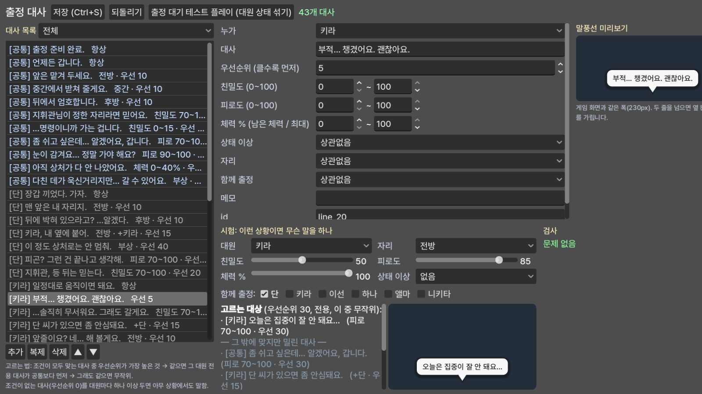

## 전투 편성 (게임 기본)
게임은 **사용자 제공 원화 캐릭터만** 배치합니다 (기본 6대2, `TestRoster.build_provided_*`):
- 아군(사람 6인): 단(돌격병 185cm, 전방)·키라(돌격병 175cm, 전방)·이선(소총수 178cm, 중앙)·하나(돌격소총수 176.8cm, 중앙)·앨마(의무병 166cm, 후방)·니키타(저격수 168cm, 후방)
- 적(괴물, 적으로만 등장): 구울(2.4m) — **전방+중앙 두 칸 차지** (`UnitData.row_span = 2`), 늑대(4m) — 후방 한 칸
  두 칸 괴물은 살아 있는 동안 전방을 막고(근접은 괴물부터), 자리 이동·교환을 하지 않으며, 두 칸의 가운데에 선다.
도형으로 생성한 12인(`build_allies/build_enemies`)은 규칙 테스트에서만 씁니다.
새 캐릭터 추가: `assets/characters/<id>/` 폴더(아래 '캐릭터 스프라이트 애니메이션') → 로스터에 `sprite_id: "<id>"`, `height_cm` 으로 등록.
캐릭터 키는 `character.json` 의 `figure_px`(원화 정수리~발 픽셀)를 화면 230px = 175cm 기준으로 환산해 2D·3D 모두에 반영됩니다.

## 배경 3D + 캐릭터 2D (하이브리드, 기본)
2D 전투의 배경은 3D 방(창·문 밖 스폿라이트, 하드 섀도우, 셀 셰이더)을 2D 가상 카메라와 **같은 투영**으로 렌더한 텍스처입니다
(`BattleView3D.configure_as_background` / `set_view`, QHD 해상도로 카메라가 움직이거나 위치·프리셋이 바뀔 때만 다시 렌더).
캐릭터는 2D 스프라이트 그대로이고, 자기 위치에 실제로 닿는 빛(원뿔 범위, 창·문 개구부 통과, 문짝 가림)을 `light_probe` 로 계산해 명암을 정합니다.
- 빛 쪽 얼굴·몸을 그 광원색으로 밝히고 반대편은 셀 그림자.
- 빛이 뒤(벽의 창·문)에서 오면 **빛 쪽 가장자리에 같은 색 림**을 더함(반대 방향 마스크의 림 구역 사용). 반대편 림은 그쪽에서 실제 빛이 올 때만.
- 보이지 않는 그림자 대리 물체로 캐릭터 그림자가 바닥에 드리워집니다.
(예전 2D 배경 판과 3D 캐릭터 전투 씬은 2026-10-27 제거.) 투영 확인용 `--bgdebug=1`(슬롯 위치 빨간 점).

## 전투 카메라
전투가 시작되면 먼저 전장 전체 구도를 약 1초 보여준 뒤 2배로 줌인하고, 이후 차례가 온 캐릭터의 몸 중심을 화면 가운데
(상단 바와 하단 명령 패널 사이 중앙)로 옮깁니다. 3D 배경은 2D 카메라의 위치·줌을 그대로 따라 다시 그려서, 줌을 해도 흐려지지 않고
화면 가장자리 캐릭터도 정확히 중앙에 올 수 있습니다. 배경 밖은 보이지 않게 제한합니다. 값은 `battle_view_2d.gd` 의 `CAM_*` 상수.
스크린샷 CLI 는 기본으로 인트로를 건너뛰며 `--intro=1`(재생), `--intro=hold`(전체 구도에서 멈춤)로 바꿀 수 있습니다.

## 캐릭터 스프라이트 애니메이션 (스프라이트 시트, Skeleton2D 리그는 제거)


캐릭터(전투·기지 공통)는 **직접 뽑은 스프라이트 프레임**으로 움직입니다. 폴더: `assets/characters/<id>/`
(`dan` 단 · `kira` 키라 · `ethan` 이선 · `hero2` 하나 · `alma` 앨마 · `nikita_army` 니키타 · `ghoul` 구울 · `wolf` 늑대 · `slime`).
- `base.png` = 기본 한 장 (지금은 예전 리그를 쉬는 자세로 합친 원화). **애니메이션 프레임이 없는 동작은 이 그림이 그대로 서 있거나 미끄러지듯 이동**합니다.
- **스프라이트 시트 넣기 (기본 방법)**: 시트 한 장을 `assets/characters/<id>/` 에 **`<동작>_<칸 수>.png`** (한 줄) 또는 **`<동작>_<열>x<행>.png`** 이름으로 두면 끝.
  예: `assets/characters/kira/walk_8.png` (8칸 한 줄), `assets/characters/kira/attack_4x2.png` (4열 2행, 빈 칸은 건너뜀). 칸은 모두 같은 크기, 왼쪽 위부터 오른쪽으로.
  **발 위치·키는 첫 칸 그림에서 자동** (그림 맨 아래 가운데 = 발, 그림 높이 = 키 → 캐릭터 키(cm)에 맞춰 크기 조절). 칸 안에서 캐릭터가 움직이는 만큼은 그대로 움직입니다.
  속도·반복 등은 같은 이름 json(선택): `walk.json` = `{"fps": 10, "loop": true, "ground": [x, y], "figure_px": 키 픽셀, "weapon": false, "durations": [초, …]}`.
- **끊기는 프레임 고치기** (시트 그림은 그대로): json 에 `"skip": [14, 15, 16]` = 그 칸 빼기, `"order": [1, 5, 13, …]` = 그 순서로 재생 (칸 번호는 왼쪽 위부터 1),
  `"align_feet": true` = 칸마다 발바닥을 같은 땅선에 맞춤 (그림마다 발 높이가 달라 위아래로 튈 때).
  (예전 적용 예: 하나 walk `skip [14,15,16]` — 그림 교체로 시트는 지움.)
- 여러 동작을 한 장에: `sheet.png` + `sheet.json` = `{"cols": 8, "rows": 4, "anims": {"idle": {"row": 0, "count": 6, "fps": 8}, "walk": {"row": 1, "count": 8}, …}}`.
- 프레임 낱장으로도 됨: `assets/characters/<id>/<동작>/0001.png, 0002.png …` (이름 순서대로 재생, 기본 12fps).
  **캔버스 크기·발 위치를 `base.png`(512×768, 발 접지점 `character.json` 의 `ground`)와 같게** 그리면 따로 설정할 것이 없습니다.
  다르면 그 폴더에 `anim.json`: `{"fps": 12, "loop": true, "ground": [x, y], "figure_px": 정수리~발 픽셀, "hip_y": 골반 y, "weapon": false}`.
- 동작 이름: 기지 `idle`(서 있기) · `walk`(이동) · `sit`(의자·소파, 골반 높이 = `hip_y`) · `sleep`(누워 자기, 눕혀 그린 그림·접지점 = 침대에 닿는 몸 가운데) ·
  `work`(업무·치료) · `clean`(청소, 없으면 work) · `train`(훈련, 없으면 work) · `talk`(대화) / 전투 `idle` · `attack` · `hit` · `heal` · `death`(마지막 프레임 유지).
  attack·hit·heal 은 한 번 재생 후 idle. 프레임이 없으면: 앉기 → 의자 앞에 서 있음, 자기 → 기본 그림을 눕힘, 전투 동작 → 간단한 앞뒤 이동·흔들림.
- 무기: **손에 붙이는 무기 그림은 기본으로 숨김** (전투는 다키스트 던전처럼 무기까지 그려 넣은 정지 그림으로 갈 예정). 필요한 동작만 `anim.json` 에 `"weapon": true` 면 손 위치(`character.json` 의 `hand`)에 붙음.
- 조명(셀 명암) 마스크: 프레임·시트만 넣어도 동작합니다(마스크 없이 고른 조명). 방향 있는 명암을 원하면 `python3 tools/char_sprites.py masks` → 프레임·시트마다 `_mask_l/_r.png` 생성 (시트를 주시면 제가 만들어 둡니다).
- 새 프레임은 게임을 다시 켜면 바로 반영 (임포트 기다릴 필요 없음).
- (선택) 움직이는 GIF·WebP → 프레임 변환: `python3 tools/char_sprites.py import nikita_army hit 파일.webp` (조명 마스크까지 만듦).
  ※ 채팅에 올린 움직이는 이미지는 첫 장면 한 장으로만 전달되므로, 시트 한 장으로 주거나 저장소에 넣어 커밋해 주세요.
- 프레임마다 보여 줄 시간을 다르게: `anim.json` 의 `"durations": [2.4, 1.2]` (초, fps 대신).
- **AI 로 만든 시트(영상에서 뽑은 6x6 등) 다듬기**: `python3 tools/char_sprites.py report <시트>` → 튀는 프레임 후보 + 이음새가 매끄러운 반복 구간 후보 (마지막 다음 프레임 ≈ 첫 프레임 — 같은 자세가 두 번 나와 멈칫하지 않게),
  `python3 tools/char_sprites.py sheet <캐릭터> <동작> <시트> --frames 15-17,19-32 --fps 16 [--align ground|cell] [--weapon 0]` → 고른 프레임만 `<동작>/` 폴더로
  선 자세가 없는 시트(뛰기 등)는 `--ref-height <다른 시트의 선 키 px> --anchor torso` (머리 크기로 시트끼리 배율이 같은지 확인)
  (칸 경계는 그림이 가장 적은 줄로 자름 · 시트 전체를 똑바로 선 칸의 키로 크기 맞춤 · `ground` = 프레임마다 발을 접지선에 붙여 카메라 흔들림 제거, `cell` = 뛰기처럼 뜨는 높이 그대로 · 누운 자세는 캔버스 자동 확장 · 조명·선화·눈 마스크 프레임마다).
- **들어간 애니메이션**: **앨마 = 사용자 제공 AI 시트 5장 다듬음** (아래 그림):
  `idle` 25장 12fps (5~29, 이음새 매끄러운 반복·눈 깜빡임) · `walk` 16장 16fps (한 걸음 주기 13~29, 튀는 18 뺌) · `run` 12장 18fps (출발 1~7·코트 안 얼룩/다리 꼬인 22~27 빼고 8~19 한 주기, 뜀 높이 그대로) ·
  `attack` 13장 12fps (행동 시트: 고개 튀는 3 빼고, 길게 멈춘 자세는 2장마다, 끝의 그냥 서 있는 12장 뺌, 무기 그림 숨김) · `death` 20장 14fps (쓰러짐 1~20 후 누운 채 유지; 누운 채 숨쉬기 21~31·일어나기 32~36 은 안 씀).
  액션·쓰러짐 시트는 발이 땅에 붙어 있는데도 칸마다 땅선이 8~16px 오르내려(카메라 흔들림) 발 기준으로 맞춤. 확인: `--scene=battle --anim_frame=a_alma:death:19` (그 프레임에 멈춤).
  **단 = 사용자 AI 시트 3장**: `idle` 30장 12fps (5~34) · `walk` 17장 16fps (16~32 한 걸음 주기) · `run` 15장 18fps (12~26 한 주기, 선 자세가 없어 서 있기 시트 키로 크기, 뜀 높이 그대로).
  **이선 = 사용자 AI 시트 3장**: `idle` 24장 12fps (5~28, 주머니에 손) · `walk` 18장 16fps (14~31 한 걸음 주기) · `run` 19장 24fps (6~24 한 주기, 주기가 길어 24fps 로 빠르게).
  **하나 walk·run = 사용자 AI 시트 + 머리는 원화로 바꿔 붙임** (AI 가 얼굴을 뭉개서): `walk` 18장 16fps (10~27) · `run` 17장 22fps (11~27). `python3 tools/char_sprites.py head hero2 walk` — 원화에서 턱 아래까지 잘라 프레임마다 원화 머리 대표 색(머리카락·피부·모자) 영역이 가장 잘 겹치는 크기·기울기·위치에 붙이고 삐져나온 AI 머리카락·조각은 지움, 묶은 머리처럼 자른 선 아래로 늘어진 머리카락도 같이 (sheet 다음에 실행, `--cut <원화 y>` 턱 바로 아래 · `--deg` 기울기 폭).
  **해상도 유지 — AI 시트 4배 확대** (하나·니키타 walk·run): AI 시트 한 칸은 키 300px 정도라 게임 그림(키 760px)으로 그냥 키우면 흐릿함 → `tools/sr_upscale.py` (Real-ESRGAN 애니 모델, torch 필요)로 시트를 먼저 4배로 키운 뒤 `sheet` 에 넣음 (`--ref-height` 도 4배 값). 발밑 바닥 그림자·외곽선 밖 흰 테는 지움.
  **니키타 = 새 기본 그림 + 리깅 idle + AI 시트 walk·run (머리 = 원화)**: `idle` 32장 12fps (리깅, 손은 주머니) · `walk` 18장 16fps (10~27) · `run` 23장 22fps (13~35, 뜀 높이 그대로) — `sr_upscale` 4배 → `sheet --ref-height 1268`(모자 너비로 원화와 배율 맞춤) → `head nikita_army <동작> --cut 157` (run 은 `--deg 6 --scale 1-1`).
  **로한 = 리깅 idle** (`rig rohan`, 32장 12fps — 예전 숨쉬기 시트는 지움).
  **하나 = 리깅 idle** (시트가 안 뽑혀 원화 한 장으로): `python3 tools/char_sprites.py rig hero2` → `idle/` 32장 12fps — 다리·골반 고정, 몸통 숨쉬기(어깨 오르내림·가슴 살짝 넓어짐), 머리 = 목 기준 갸웃·끄덕(숨보다 조금 늦게), 팔 = 어깨 기준 흔들림(팔·몸통 빈틈으로 팔 영역, 빈틈 없는 쪽은 반대 팔 너비로). **눈 깜빡임 없음** (눈 자리를 피부로 덮는 방식이 얻어맞은 것처럼 보여 뺌 — 도구 `--blink` 로만). 조명·선화·눈 마스크도 같은 움직임.
  **키라 = 사용자 AI 시트 3장**: `idle` 36장 10fps (1→19→2 왕복 — 시트 19장 안에 매끄럽게 이어지는 반복 구간이 없어 앞뒤로 재생) · `walk` 19장 17fps (17~35 한 걸음 주기, 서 있기 키로 크기) · `run` 12장 18fps (15~26 한 주기, 뜀 높이 그대로).
  `breathe` (기본 그림으로 숨쉬기 idle 시트)는 이제 쓰는 캐릭터 없음 — 전원 리깅 또는 AI 시트.
  프레임을 지우거나 다시 만들 때 남은 `.import` 파일은 무시됨 (원본 PNG 가 있는 프레임만 읽음).
  속도는 같은 이름 json(`walk.json` 등). 조명 마스크 시트(`*_mask_r/_l.png`)는 `python3 tools/char_sprites.py masks` 로 칸마다 만듦 — 없어도 동작.

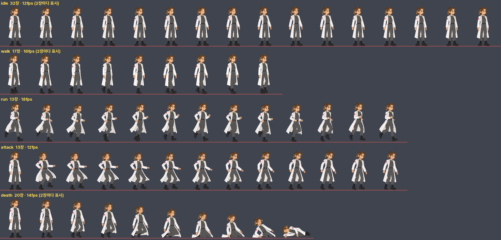
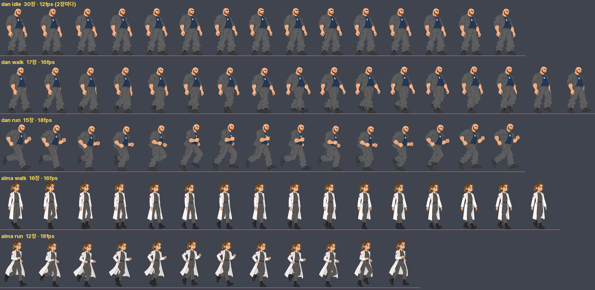
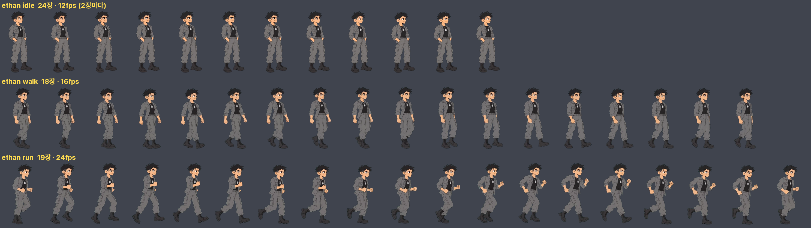
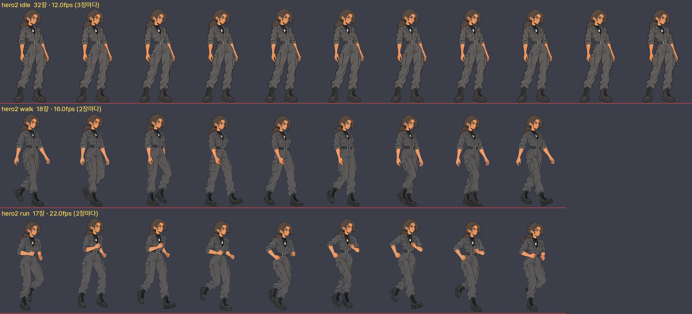
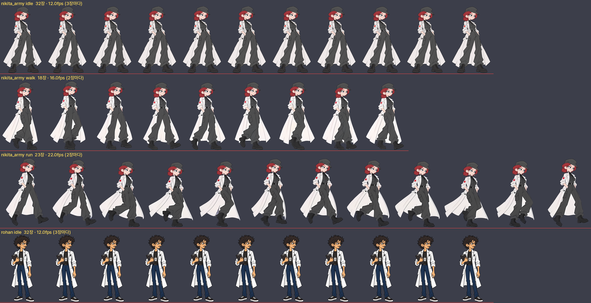
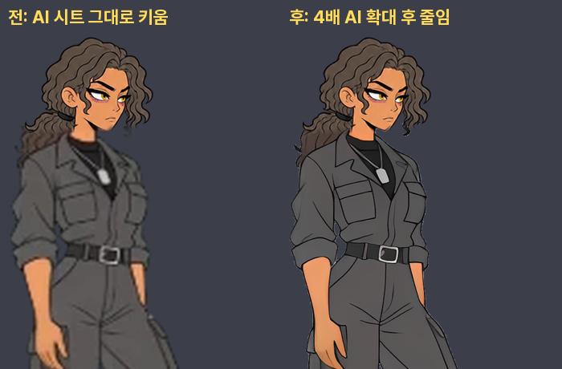
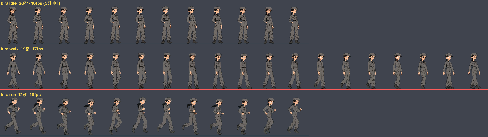

### 효과음 (발자국 · 쓰러짐)
- **발자국**: 캐릭터마다 걷기·뛰기 소리 (아군 6명 모두: **키라 · 니키타 · 이선 · 하나 · 앨마 · 단**). 걷기·뛰기 애니메이션에서 **발이 땅에 닿는 프레임**마다 한 걸음씩 재생 → 애니메이션 속도가 달라도 발과 소리가 맞음.
  - 기지: 대원이 걷거나 뛸 때. 전투: 자리 이동·자리 바꾸기 때 두 걸음 (전투는 멈춘 그림으로 미끄러지므로).
  - 화면 위치 소리(가운데에서 멀수록 작게, 좌우로 나뉨). 소리 파일이 없는 캐릭터는 조용함.
- **쓰러짐(dead)**: 공용 — 전투에서 아군·몬스터 누구든 쓰러질 때.
- 새 소리 넣기: `python3 tools/sfx_steps.py <캐릭터 id> walk|run <발자국.mp3> [--skip 1]` → 걸음마다 잘라 `assets/characters/<id>/sfx/walk_01.ogg …` (원본은 `assets/source/sfx/`, 다른 걸음보다 4dB 넘게 작거나 큰 조각은 크기를 맞춤).
  공용: `python3 tools/sfx_steps.py --common <이름> <소리.mp3>` → `assets/sfx/<이름>.ogg`.
  발 닿는 프레임: `python3 tools/char_sprites.py steps <캐릭터>` → anim.json `"steps"` (걷기 = 두 발이 가장 벌어진 프레임, 뛰기 = 가장 낮은 프레임 · 직접 고쳐도 됨).
- [임시] 음량: `scripts/presentation/sfx.gd` 상단 (`FOOTSTEP_DB` 0 · `DEAD_DB` -3 dB).

### 선화 유지 (조명은 면에만)
캐릭터 그림마다 **선화 마스크**(`<그림>_line.png`, `python3 tools/char_sprites.py lines`, `new` 는 자동)를 두면 셰이더가 **선은 원화 색 그대로** 두고 면에만 조명을 입힙니다.
선 = 주변보다 가늘게 어두운 획(외곽선·주름·눈·머리카락 선), 넓게 어두운 면(검은 옷)은 선이 아니라 조명을 받음. 선 옆 밝은 테두리는 조명색 유지(어두운 쪽만 원화로).

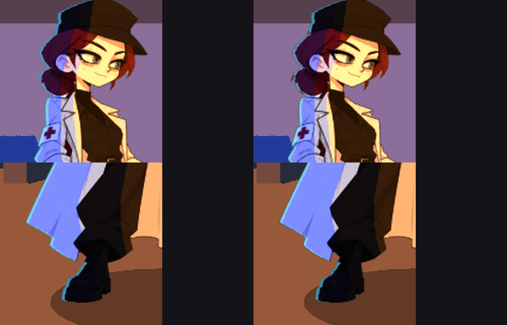

### 새 캐릭터 그림 시험하기
1. 투명 배경 전신 그림 한 장 → `python3 tools/char_sprites.py new <id> 그림.png` → `assets/characters/<id>/` (기본 그림·조명 마스크·초상화·그림자·character.json, 키 760px·발·머리·손 위치 자동).
2. 실행할 때 `--test_char=<id>` (+ `--test_slot=a_kira` 등, 기본 니키타 자리)를 붙이면 그 자리 캐릭터만 새 그림으로 전투·기지에 나옴 (데이터는 그대로).
   예: `godot --path . ++ --scene=battle --test_char=test` / `++ --scene=base --test_char=test`. 계속 쓰려면 엑셀 `캐릭터`·`대원` 시트 `스프라이트` 열에 `<id>`.
- 지금 들어 있는 시험 캐릭터: `test` (빨간 머리 의무병, 흰 코트·주머니에 손, 사용자 제공, 네온 칠). 흰 배경(불투명) 그림이면 `new` 가 가장자리에서 이어진 흰 바탕만 자동으로 지움 (외곽선 안쪽 흰 옷은 그대로).

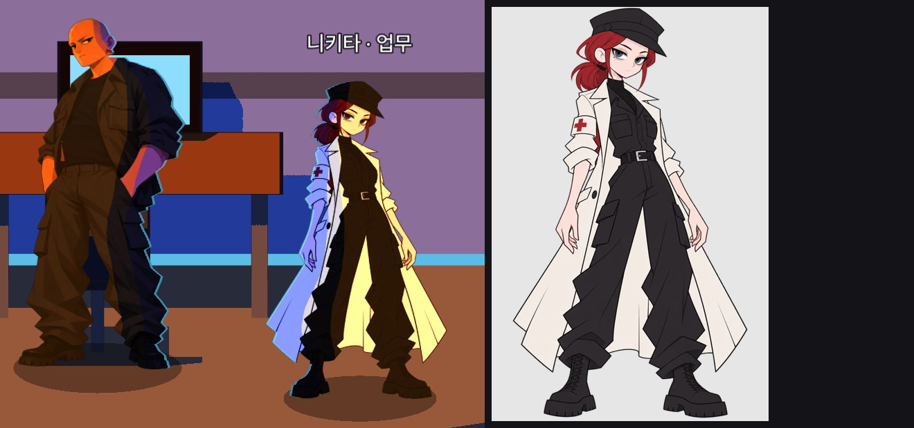

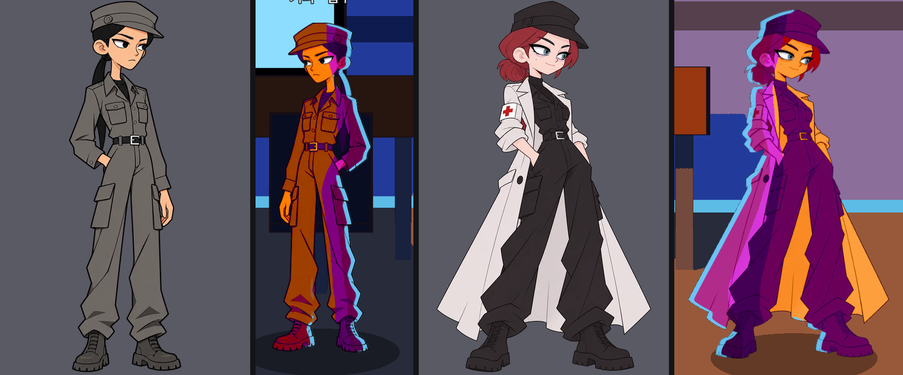
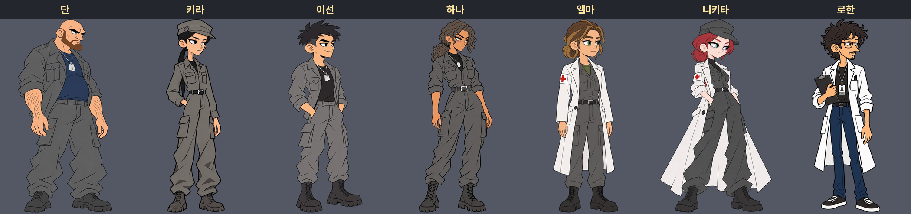
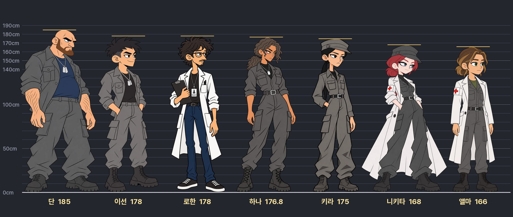
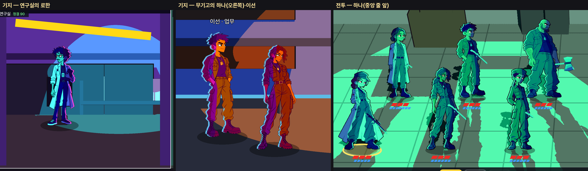
- 키 = 그림 맨 위(모자 포함) ~ 발. (필요하면 `python3 tools/char_sprites.py hat <캐릭터> <모자 아래 y>` 로 모자 절반까지만 키로 셀 수 있음 — 지금은 안 씀, 0 이면 해제.) 비교 그림: `python3 tools/height_chart.py`.
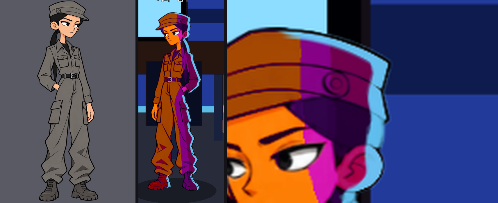
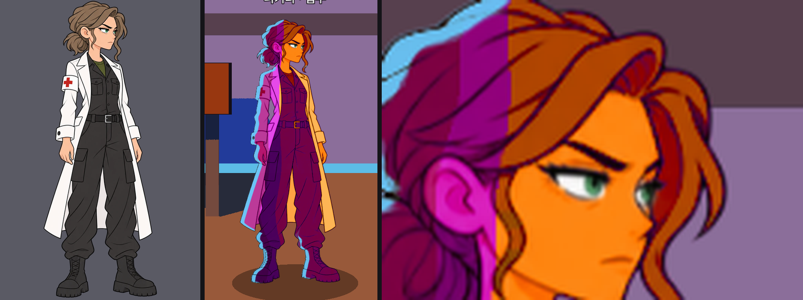
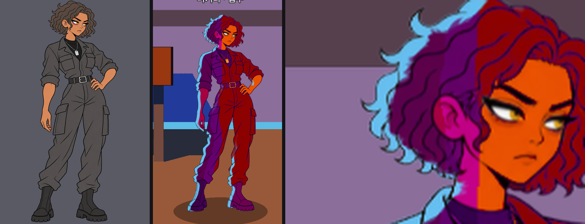

### 네온 칠 (전 캐릭터 기본)
모든 캐릭터를 **선화는 원화 그대로, 면은 조명색으로 쨍하게** 칠합니다 (레퍼런스: `docs/screenshots/ref_neon.png`).
- 원화 밝기 → 조명색 명도. 검정 옷도 바닥 밝기(`neon_floor`)까지 올라가 깊은 보라·남색이 되고, 흰 코트는 흰빛 섞인 조명색. 선은 그보다 어두운 원화 색이라 묻히지 않음.
- **외곽 림**(빛 반대쪽 가장자리의 보조광 선): 셰이더가 그림 실루엣에서 직접 그림 — 두께 `rim_px`(원화 키 760px 기준 14px), 실루엣을 따라 매끄럽게(계단 없음). 바깥이 트인 가장자리에만 생김 — 그림 안쪽 작은 틈(턱 아래·목 옆·밑단과 부츠 사이)엔 안 듦. 머리카락 끝 같은 가는 끝까지 채움(림 띠 안에서는 어두운 먹선만 선화로 남김).
- **눈은 원본 색**: 눈 마스크 `base_eye.png`(흰자·눈동자·동공)가 있으면 그 부분은 조명·네온 없이 원화 색. `python3 tools/char_sprites.py eyes <캐릭터> [x0,y0,x1,y1 …]` (상자 없으면 머리 영역에서 자동, `new` 는 자동). 지금은 시험 캐릭터만.
- `character.json` `"style": "classic"` → 예전 셀 칠. `"neon_gradient": 1` → 몸 위(빛 쪽)에서 아래로 조명 색상이 푸른 보라 쪽으로 넘어가는 그라데이션 (기본 끔).
- 실행 옵션으로 비교: `--char_style=neon|classic`, `--char_gradient=0|1` (모든 캐릭터에 강제). 세기는 셰이더 `neon_*`·`rim_px` 값.
- 기지 확대 촬영: `--base_focus=npc_nikita --base_zoom=3.6 --base_focus_y=0.9`.

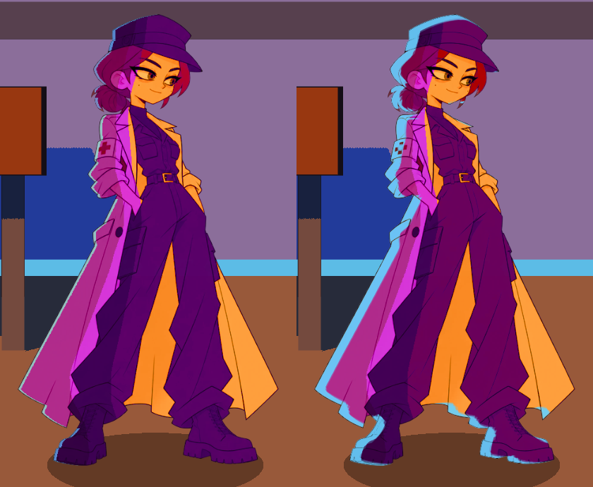
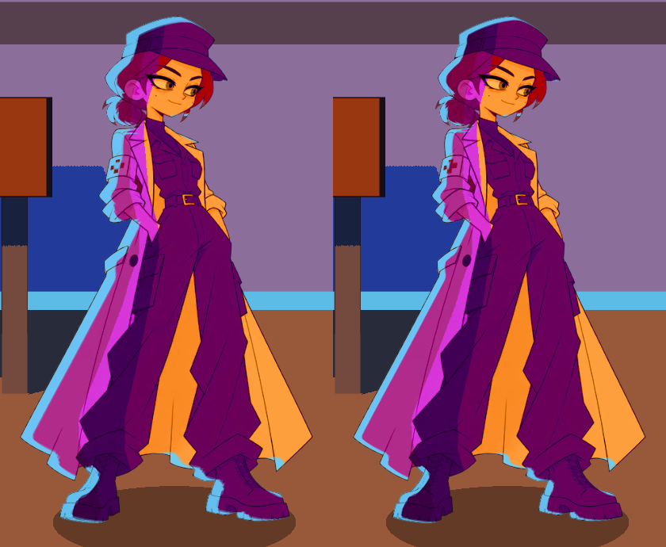
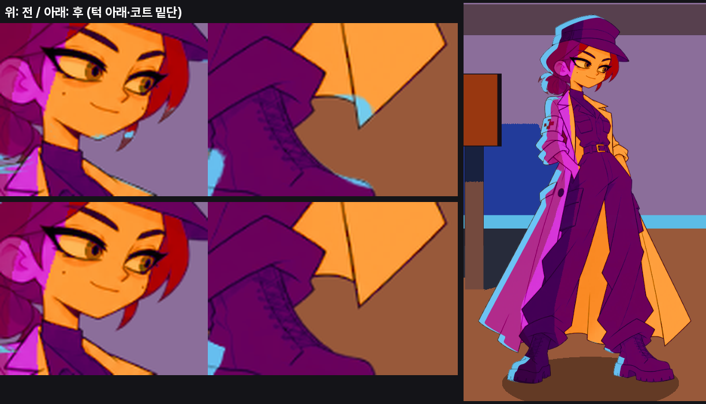
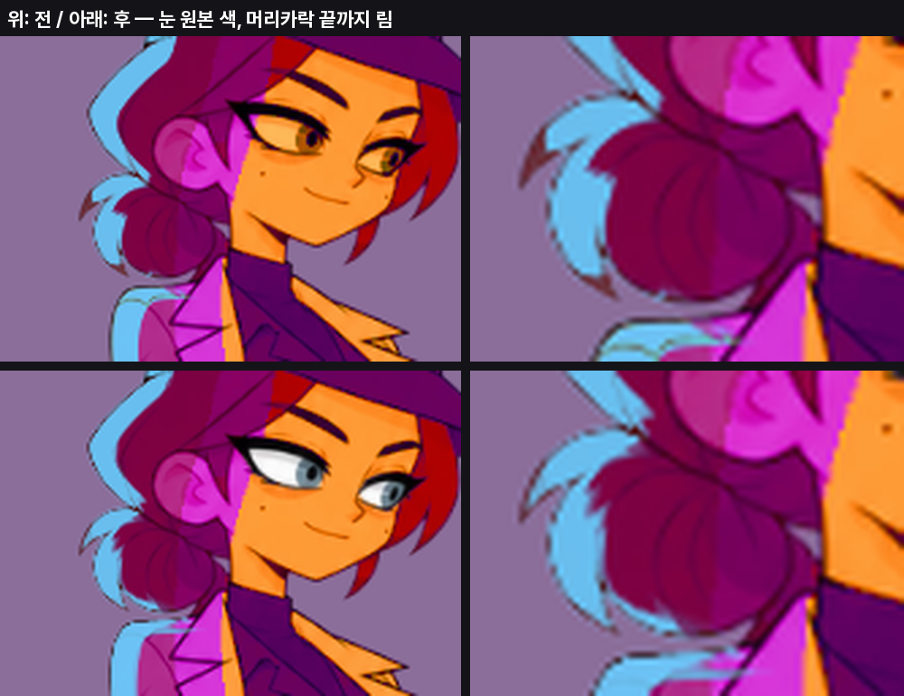
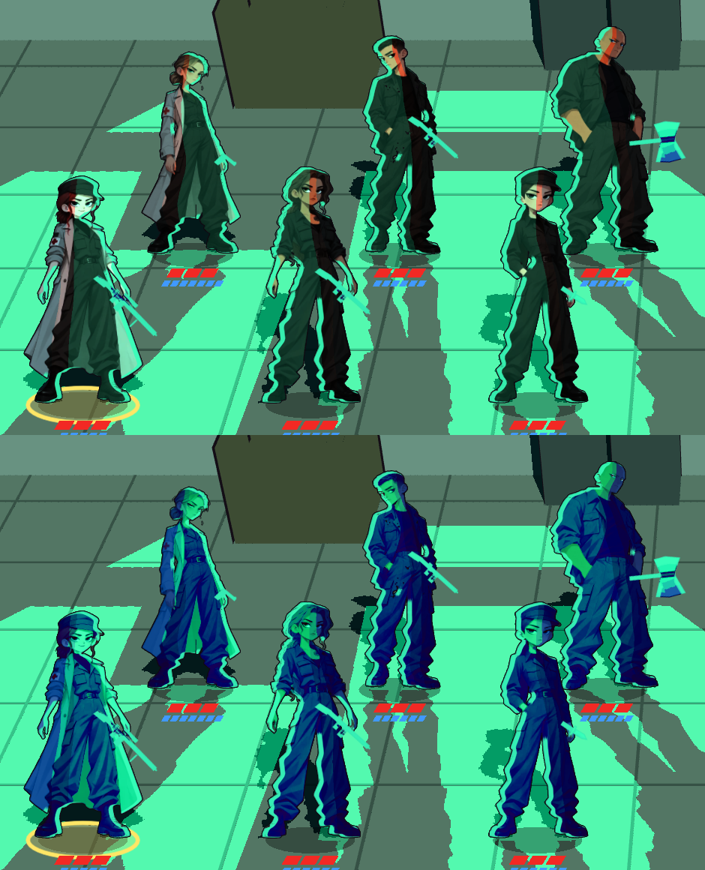
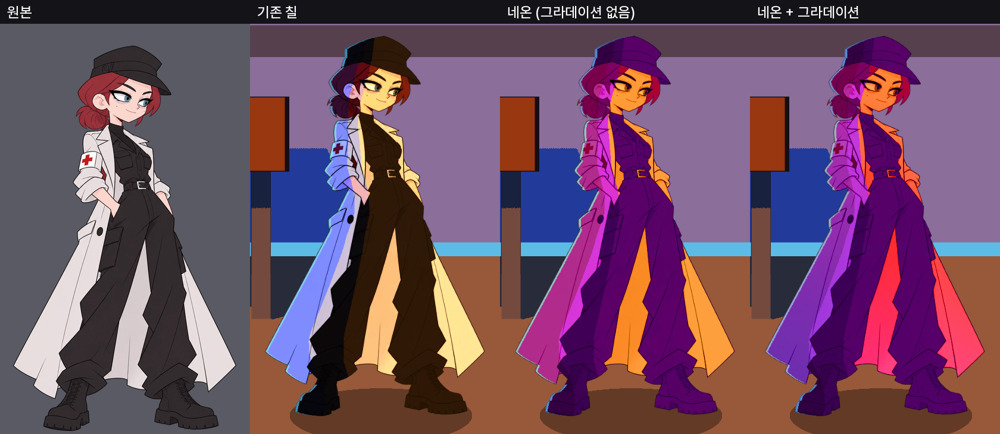
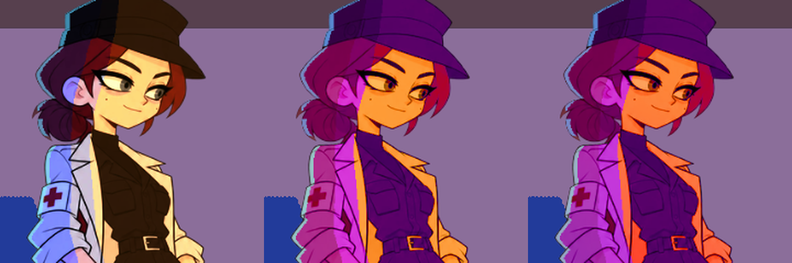

## 규칙 테스트 (헤드리스)
```
godot --headless --path . --import          # 최초 1회 (클래스 캐시 생성)
godot --headless --path . -s tests/run_tests.gd
```
전투: GDD 8절 "필수 검증 사례" (선공 특례, 2라운드 미적용, 동률 아군/레벨/원거리 우선, AP 상한 버림/이월/0 자동 종료,
이동/교환 AP 1, 무기 변경 AP 1, AP 부족/무효 대상 시 AP 미소모, 재시작 초기화, 시드 재현성) + 큰 몸집·장착·상태 이상·엑셀·AI 그래프.
기지([15]~[24], `tests/outgame_tests.gd`): 날짜 전환(23:59→다음 날·월말·연말), 해금(부족/정확/초과/중복), 잠긴 방 경로·7일 이동, 요일별 일정·해금 → 생활 변화,
대화/엿듣기/요청 구분, 일일 오염·청소·위임, 주간 결산 중복 없음, 월 1회 점검·그 주 보너스, 훈련·제작·강화 → 전투 수치, 저장/불러오기 복구, 출정 대사 고르기·출정 불가 대원([31]), 연구원 로한·무기 연구([32]), 레벨·스킬 트리([33]), 신앙([34]), 스킬 트리 데이터·에디터·신앙 데이터([35]), 전투 상태 이상([13b]), 상태 id → 효과 · 넉백·끌어당김·표식·도발·취약·재생·보호막([13c]), 몬스터 스킬([35]), 세계관 도감·믿는 신([13d]), 신 해금 캐릭터·기적·해금 조건·미션 완료([34b]). 현재 471개 통과.

## 스크린샷 일괄 렌더
```
GODOT=/path/to/godot tools/render_shots.sh docs/screenshots      # Xvfb + Mesa 소프트웨어 렌더, QHD 출력
```
CLI 인자(`++` 뒤): `--scene=battle|formation|result|menu|title|base --mode=2d|3d --preset=g1..g4 --shot=경로 --autoplay=aim|move|fight:N --hud=0`.
디버그: `--charview=1`(캐릭터 원화를 조명 없이 출력), `--outline=0`(외곽선 끔), `--rim=0`(림 끔).
기지: `--scene=base --base_skip=분 --base_cam=x,y,화면높이(m) --base_ui=dialogue:npc_alma|overhear|unlock:f1_mess|facility:b1_workshop|character:npc_kira|contracts|context:npc_dan|clean:npc_kira|debug|sortie|unlockall`.

## 폴더
```
scenes/            title, main_menu(전투 테스트), formation, battle_2d, battle_hud, result, outgame/base_hub
scripts/battle/    규칙 계층 (표현 비의존): unit_data, action_data, unit_runtime, slot_manager,
                   turn_scheduler, ap_component, target_validator, action_resolver, enemy_ai, battle_controller
scripts/presentation/  battle_view_base (공통 인터페이스), battle_view_2d + unit_sprite_2d + character_sprite_2d(프레임 애니메이션) + slot_marker_2d,
                   battle_view_3d(전투 배경 3D 방), lighting_presets
scripts/ui/        battle_hud, title, main_menu, formation, result
scripts/outgame/   기지 규칙 (화면 비의존): outgame_data(엑셀·일정·단면 좌표), world_clock, room_route_service, npc_schedule_resolver,
                   npc_agent, economy_ledger, base_sim(해금·이동·대화·위생·의뢰·결산·점검·제작·저장) / base_hub(씬)
scripts/outgame/view/  base_view_3d(3D 단면 건물·조명·카메라), base_overlay(이름표·자물쇠·오염·말풍선 — 화면 좌표), npc_view(대원 스프라이트), outgame_hud(HUD·창)
addons/            rtz_ai_editor, rtz_stage_editor, rtz_schedule_editor, rtz_battle_editor, rtz_sortie_editor, rtz_skill_editor, rtz_quest_editor (Godot 에디터 상단 탭)
data/              balance.xlsx(전투), skill_tree.json(스킬 트리 노드), faith.json(신·신앙 스킬·믿는 신·신 해금 캐릭터·기적), codex.json(세계관 도감), quests.json(퀘스트), statuses.json(상태 정의: 이름 → 효과), skill_status.json(스킬 상태 이상), monster_skills.json(몬스터 스킬), outgame.xlsx(기지), ai/, stages/, outgame/schedules/
scripts/data/      test_roster (임시 테스트 데이터 12인 + 행동 7종)
shaders/           cel_character (2D 캐릭터), outline_group (캐릭터 외곽선), flat_zone_fill, cel_3d, outline_3d, unlit_3d
assets/characters/ 캐릭터별 base·프레임 애니메이션·마스크·character.json (전투·기지 공통)
assets/sprites/    무기 스프라이트 + 구역 마스크 (_mask_r/_mask_l) + 옛 테스트 캐릭터 + manifest.json
assets/textures/   배경 플레이트 + 마스크, 3D 얼굴 데칼
setup/             install_windows.ps1, install.sh (기기 설치), play.bat / play.sh / play.command (루트, 실행)
tools/             gen_sprites.py (원화·마스크 생성기), char_sprites.py (애니메이션 프레임 조명 마스크), render_shots.sh,
                   gen_balance_xlsx.py / gen_outgame_xlsx.py (엑셀·일정 초기 생성 — 이미 있으면 덮어쓰지 않음)
tests/             run_tests.gd, outgame_tests.gd
docs/              design/ (기획서 사본, outgame/ = 아웃게임 기획 01~04 + 구현 현황 05), screenshots/, 2D_vs_3D_comparison.md
```

## 데이터 흐름
`BattleController` 가 상태 머신(PREPARE → INITIATIVE → ROUND_START → ACTOR_START → PLAYER_COMMAND/ENEMY_AI → ACTION_RESOLVE → …)을 돌리며
신호만 내보내고, `BattleView2D`/`BattleView3D` 는 같은 `BattleViewBase` 인터페이스로 그 신호를 연출로 바꿉니다.
모든 행동은 `can_execute → pay_ap → resolve → emit_event` 한 경로(`BattleController._execute`)를 지납니다.

## 임시 에셋 주의
캐릭터/배경은 `tools/gen_sprites.py` 가 도형으로 생성한 **검증용 대체 원화**입니다. 레퍼런스 이미지는 포함하지 않았습니다.
