# 2D vs 3D 표현 비교 — 결정용 자료

> **결정: 2D 채택** (2026-10-25). 후속으로 사용자 제공 캐릭터를 Skeleton2D 컷아웃 리그로 투입한 비용 테스트는 `skeleton2d_cost.md` 참조. 아래 2D 스크린샷의 '라온'이 그 캐릭터다.

같은 전투 규칙(`scripts/battle/*`), 같은 HUD, 같은 조명 프리셋(G1~G4)을 두 표현 계층에 올려 렌더한 결과입니다.
모든 이미지는 Godot 4.7 `gl_compatibility` 소프트웨어 렌더(Xvfb + Mesa llvmpipe) 캡처이며, 캐릭터/배경은 검증용 대체 원화입니다.

## 한눈에 보기 (G1 청록 + 핑크, 레퍼런스 1 대응)

| 2D (원화 + 구역 마스크 셰이더) | 3D (셀 셰이더 + 실광원) |
|---|---|
|  | 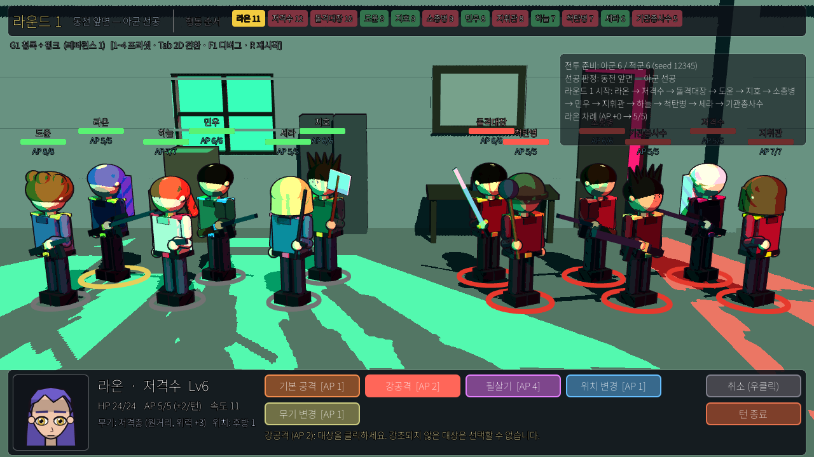 |
| HUD 없이 | HUD 없이 |
| 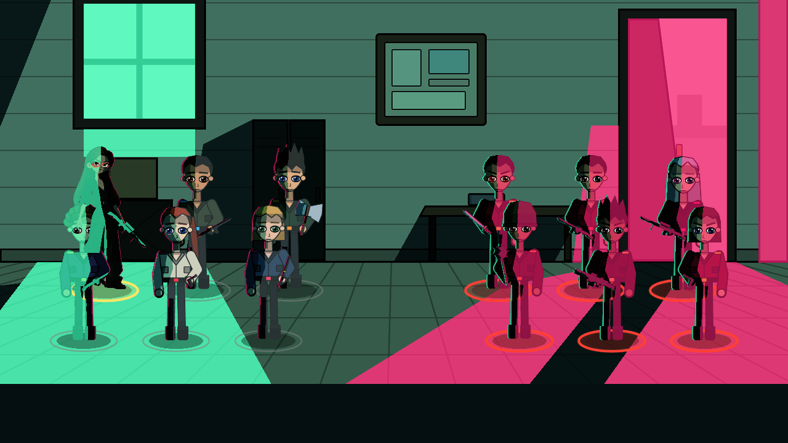 | 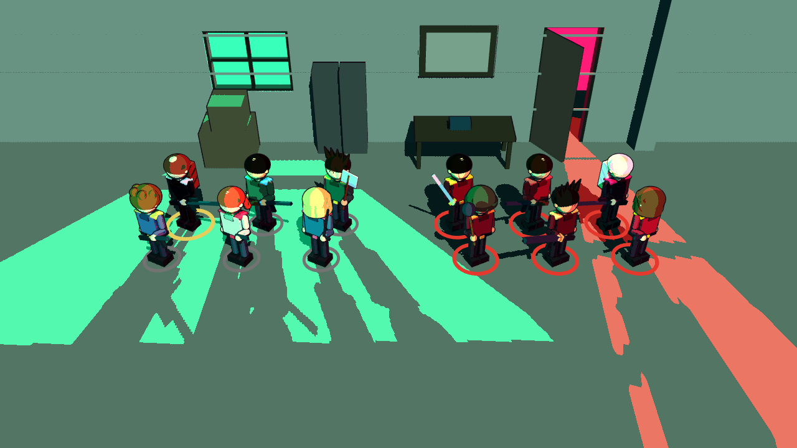 |

## 조명 프리셋 교체 (G3 검증: 소스 재제작 없이 색 분위기 교체)

| 프리셋 | 2D | 3D |
|---|---|---|
| G2 초록 + 강한 빨강 (레퍼런스 3) | 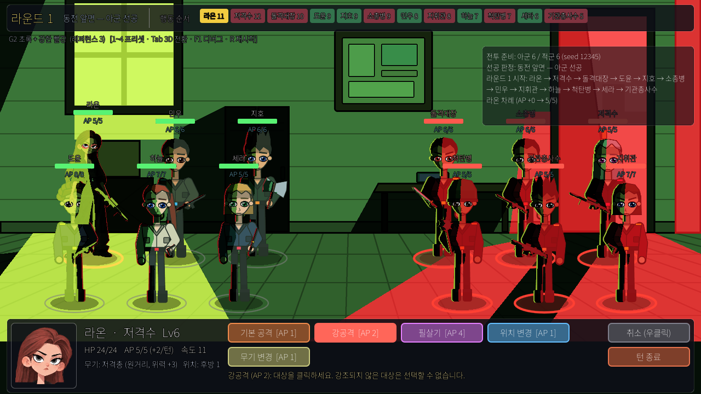 | 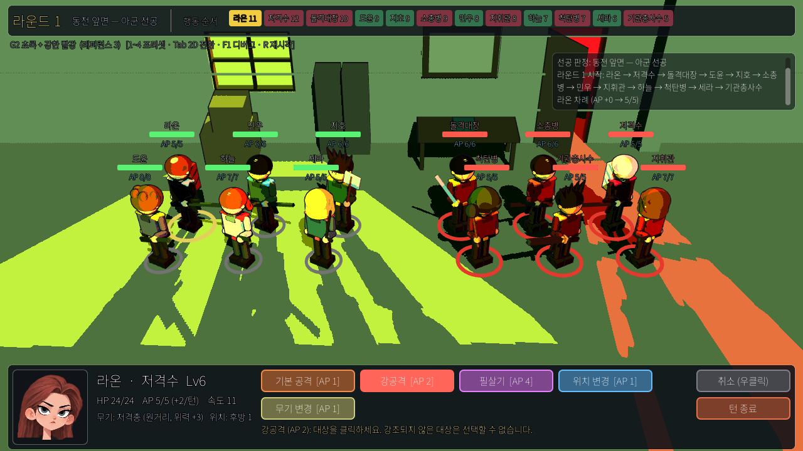 |
| G3 남청 + 주황 (레퍼런스 4) | 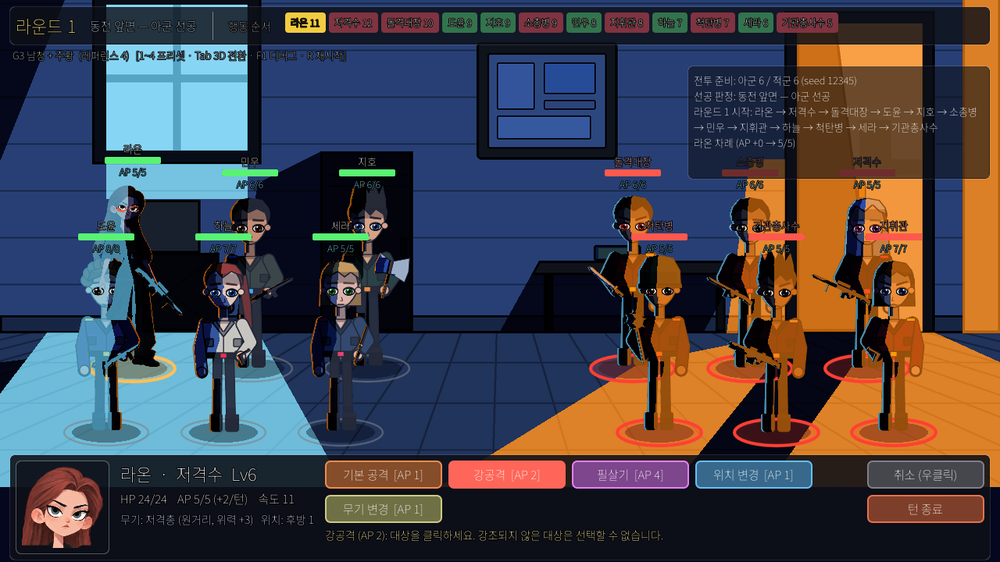 | 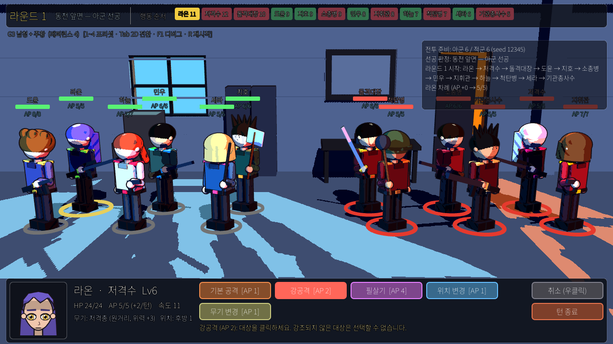 |
| G4 보라 + 시안/마젠타 (레퍼런스 2) | 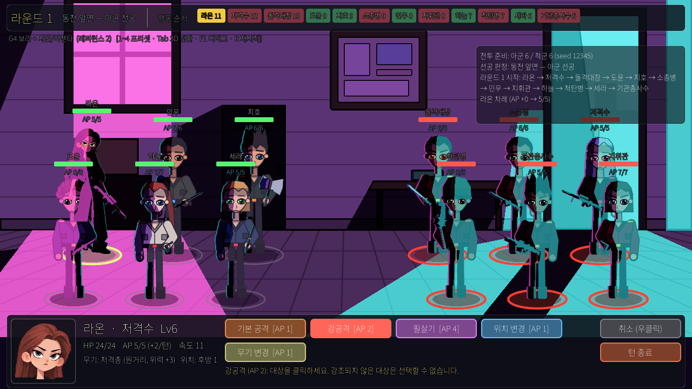 | 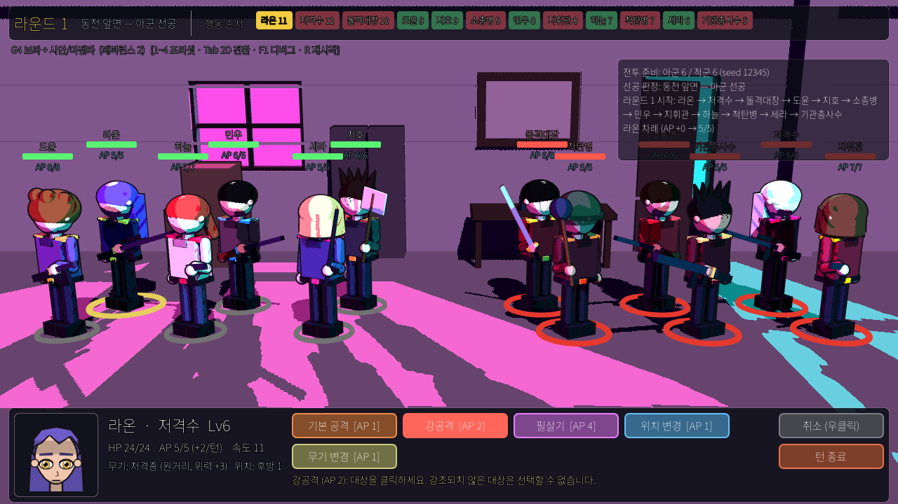 |

## 전투 중 가독성 (G4 검증: 강한 조명 위에서 현재 캐릭터·대상·HP·AP 식별)

| 상황 | 2D | 3D |
|---|---|---|
| 교전 후 (피해 팝업·사망·타임라인) | 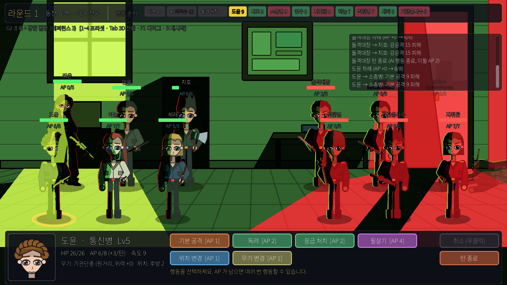 | 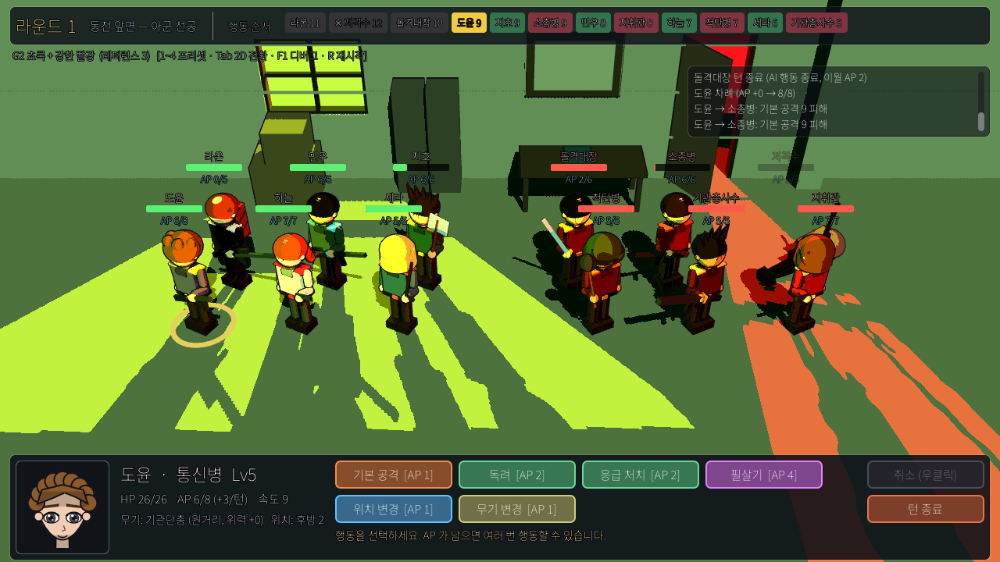 |
| 위치 변경 마커 (이동/교환) | 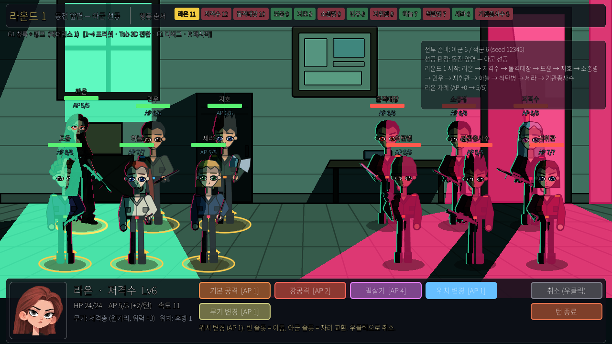 | 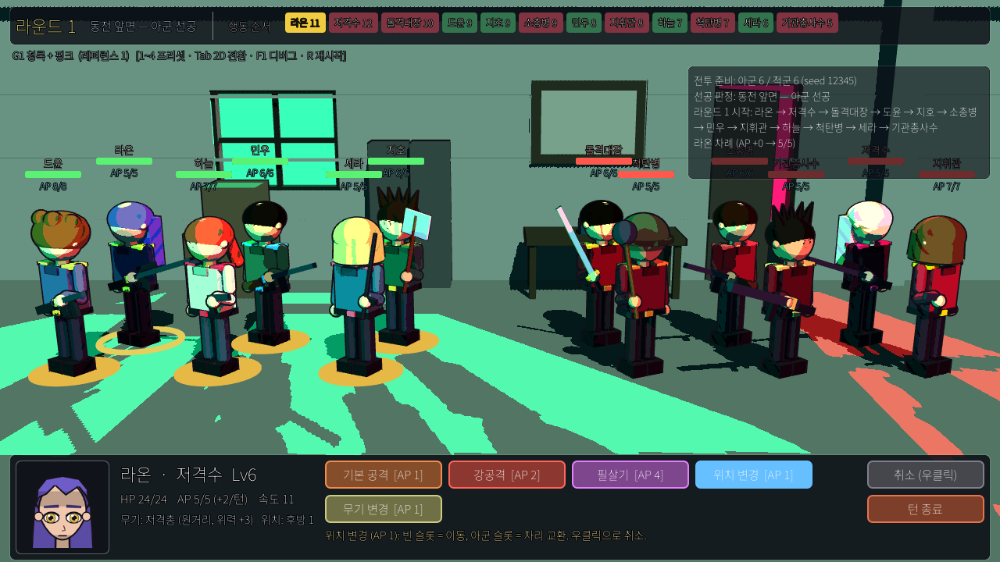 |
| 다른 프리셋 교전 | 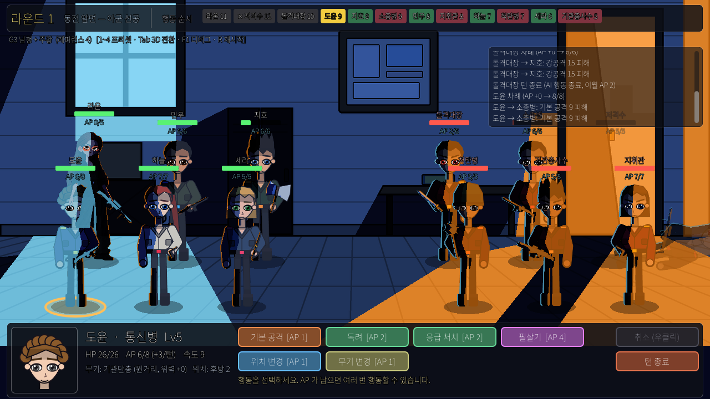 | 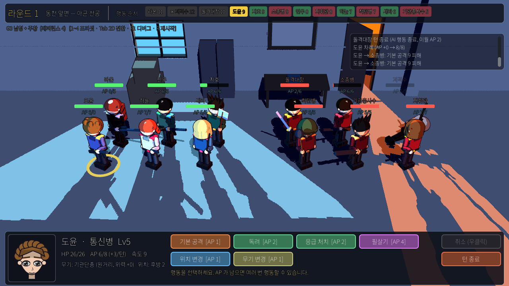 |

## 구현 방식 요약

| 항목 | 2D | 3D |
|---|---|---|
| 조명 원리 | 원화마다 **구역 마스크**(그림자/주변광/고유색/키/보조광 5코드)를 두고 `cel_zoned_lighting.gdshader` 가 프리셋 색으로 재착색. 빛의 형태는 사람이 마스크에 그린 폴리곤 | SpotLight3D(문/창 밖) + 캐릭터 전용 홍수광 + 약한 방향 채움광. `cel_3d.gdshader` 가 광원별 닿음/안 닿음을 1단계로 끊고, 닿으면 `mix(고유색, 광원색)` 로 **덮어쓰기**(가산 누적 방지), 안 닿으면 주변광/그림자 색 |
| 하드 에지 광면 | 마스크 폴리곤 그대로 → 항상 의도한 모양 | 개구부(문/창)를 통과한 실제 빛 + 하드 섀도우 → 물체가 움직이면 그림자도 따라감 |
| 캐릭터 셀 명암 | 마스크의 세로 터미네이터(60% 빛/15% 주변/25% 그림자 + 림) | 법선 기반 1단계 + 역면 외곽선. 얼굴은 조명 무시 데칼(가독성) |
| 색 교체 비용 | 유니폼 4색 교체 = 즉시 (G3 검증 통과) | 광원 색 3종 교체 = 즉시 (G3 검증 통과) |
| 움직이는 조명 | 불가(마스크 고정). 캐릭터가 다른 빛 영역으로 이동하면 **슬롯 기준으로 키/보조색을 바꿔치기**해 근사 | 가능. 이동·교환 시 자동으로 바뀜 |
| 원화 의존도 | 높음: 캐릭터마다 원화 + 마스크(좌/우 광원 2종) 필요. 애니메이션 프레임마다 마스크도 필요 | 낮음: 모델 1개 + 색만. 애니메이션은 본으로 해결 |
| 프로토타입 구현량 | 생성기 580줄 + 뷰/스프라이트 420줄 | 모델/뷰 620줄 |

## 관찰 (렌더 결과 기준)

**2D**
- 레퍼런스가 요구한 "넓은 색면이 공간을 가르는" 인상이 가장 직접적으로 나온다. 문 밖 핑크 / 창 아래 민트 / 사물함 그림자가 모두 작가가 그린 폴리곤이므로 구도가 깨지지 않는다.
- 캐릭터도 같은 셰이더를 쓰므로 배경과 톤이 일치한다. 눈은 고유색 유지 구역(128)으로 처리해 어떤 프리셋에서도 읽힌다.
- 약점: 캐릭터가 서 있는 빛 영역에 따라 **슬롯 단위로만** 색이 바뀐다(연속적인 이동 중에는 어색). 애니메이션을 넣는 순간 모든 프레임에 마스크가 필요하다. 회전/방향 전환마다 마스크 세트가 늘어난다(지금도 좌/우 광원용 2장).

**3D**
- 문 모양으로 바닥에 떨어지는 핑크 광면과 캐릭터의 **긴 하드 섀도우**는 3D가 더 자연스럽고, 위치 이동 시 자동으로 변한다.
- 색 공간 분리 강도는 광원 배치로 조절되며, 2D만큼 '그래픽 디자인적으로 정확한' 면 분할은 어렵다. 가산 광원 특성상 겹치는 자리(바닥 중앙)는 밝아진다.
- 캐릭터 실루엣은 기본 도형 조합이라 5번 레퍼런스의 선·형태감과 거리가 있다. 본격 비교에는 정식 모델(외곽선 전용 법선 포함)이 필요하다. 얼굴은 데칼이라 조명 변화에 둔감하다.
- 소프트웨어 렌더에서도 60fps 급으로 가볍다(그림자 3개).

## 결정에 쓸 질문
1. **확정된 목표 "2D 게임 렌더링"**(02_graphics v0.2 §1)을 유지한다면 2D 경로 A 가 그대로 본편 파이프라인이 된다. 추가로 필요한 것은 원화/마스크 규격과 애니메이션 방식(프레임 vs 본)뿐이다.
2. 전투 중 **이동·교환·연출에서 빛이 캐릭터를 따라 변해야** 한다면 3D(또는 2D + Light2D 경로 B)로 가야 한다. 3D는 색 공간 분리의 '정확한 모양'을 일부 포기하는 대신 자동화를 얻는다.
3. 절충안: **배경은 2D 구역 마스크(정확한 색면)**, **캐릭터만 3D 셀 셰이딩**(또는 2D 노멀맵 + Light2D)으로 빛을 따라가게 하는 혼합. 이번 프로토타입의 뷰 인터페이스(`BattleViewBase`)는 두 계층을 섞어도 규칙 코드를 건드리지 않는다.

> 제작자 의견: 레퍼런스 1~4의 '사람이 디자인한 색면' 느낌과 5번의 선화 캐릭터 화풍을 동시에 만족시키기에는 **2D 경로 A 가 더 가깝다**. 3D 는 움직이는 그림자라는 장점이 분명하지만, 지금 목표 그림체에 맞는 3D 캐릭터(외곽선·셀 명암용 모델링)를 만들어야 하는 비용이 추가된다.
