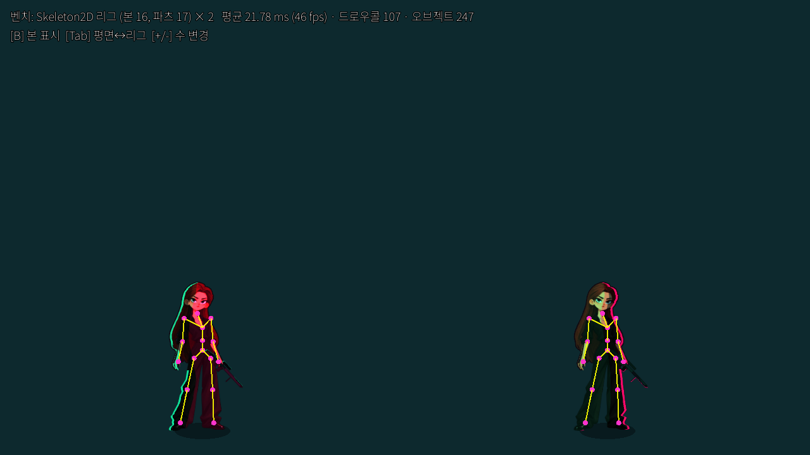
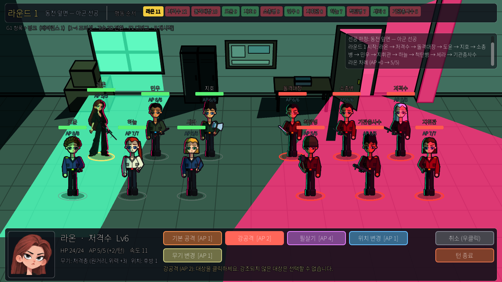

# Skeleton2D 컷아웃 리그 비용 테스트 (2D 확정 후)

대상: 사용자가 제공한 캐릭터 원화 1장(1024×1536, 투명 배경)을 **그대로 전투에 투입**하고 Skeleton2D 컷아웃 리그를 얹었을 때의
제작 비용과 런타임 비용. 전투에서는 아군 '라온'(저격수) 슬롯을 이 캐릭터가 대신한다.

| 리그 구조 | 전투 투입 |
|---|---|
|  |  |

## 1. 파이프라인 (원화 1장 → 리그)

| 단계 | 도구 | 수동/자동 | 이번 캐릭터 소요 |
|---|---|---|---|
| 1 색 분류 (머리카락 / 피부 / 어두운 의상) | `tools/rig_cutter.py classify()` | 자동 | 임곗값 2회 조정 |
| 2 부위 폴리곤 17개 좌표 | `rig_cutter.py PARTS` | **수동** | 좌표 격자 보고 1회 작성, 수정 0회 |
| 3 관절(본) 16개 좌표 | `rig_cutter.py BONES` | **수동** | 1회 작성 |
| 4 폴리곤 ∩ 색분류 → 파츠 PNG + 이음새 1px 팽창 | 자동 | 자동 | — |
| 5 전신 구역 마스크(5코드) → 파츠별 크롭 (좌/우 광원 2종) | `gen_sprites.build_zone_mask(smooth=90)` | 자동 | — |
| 6 Bone2D 트리 + 파츠 Sprite2D + 셰이더 머티리얼 | `RiggedUnit2D.build()` (rig.json 읽어 생성) | 자동 | — |
| 7 애니메이션 idle / attack / hit / heal / death | `RiggedUnit2D._build_animations()` 본 회전 키 | **수동(코드)** | 5개, 약 40 키 |
| 8 무기 부착 (손 본), 초상화(head 파츠), 클릭 영역 | `UnitSprite2D._build_rigged()` | 자동 | — |

- 수동 입력 합계: 폴리곤 17개 + 본 16개 + 애니 키 약 40개. 숙련된 작업자가 에디터 없이 좌표만 적는 방식으로 **1캐릭터 1~2시간**,
  Godot 에디터의 Polygon2D/Bone2D UI 를 쓰면 더 빠르지만 대신 씬 파일이 캐릭터마다 생긴다.
- 원화 쪽 요구: 팔·다리가 몸통과 겹치지 않는 A/T 포즈에 가까울수록 인페인팅이 줄어든다. 이 원화는 팔이 몸 옆에 내려와 있어
  소매 뒤 몸통을 자를 필요가 없었다. 머리카락이 어깨 앞/뒤로 나뉘어 `hair_front`/`hair_back` 2장으로 분리했다.
- 레퍼런스 화풍(5번)과 임시 생성 원화를 같은 화면에 두면 톤 차이가 분명하다(아래 스크린샷). 정식 원화는 이 캐릭터 기준으로 통일하는 게 맞다.

## 2. 에셋 비용 (캐릭터 1명)

| 항목 | 평면 스프라이트(생성 원화, 256×512) | Skeleton2D 리그(이 원화, 1024×1536) |
|---|---|---|
| 원화 PNG | 1장 (≈25 KB) | 파츠 17장 (≈751 KB, 원본 618 KB) |
| 구역 마스크 | 2장 (좌/우 광원) | 34장 (파츠 17 × 좌/우) ≈ 89 KB |
| 정의 데이터 | manifest.json 항목 1개 | rig.json (본 16, 파츠 17, 피벗) |
| GPU 텍스처 메모리(대략) | 0.5 MB | 6 MB + 마스크 1.5 MB (해상도 그대로일 때) |
| 방향 반전 | flip + 반대 마스크 | 동일 (리그 전체 미러) |
| 애니메이션 | 트윈(튀어나감/흔들림) | 본 키프레임. 프레임 추가 시 **원화 추가 없음** |

> 원화를 512 폭으로 줄이면 텍스처 메모리는 1/4 이 된다. 전투 화면에서 캐릭터 높이는 약 230 px 이므로 1024 폭 원화는 과하다.

## 3. 런타임 비용 (소프트웨어 렌더 llvmpipe, 1280×720, 상대 비교용)

`scenes/rig_bench.tscn` 에 N명을 띄우고 idle 애니메이션 재생 상태로 180프레임 평균. `--scene=bench --count=N --rig=0|1 --bench_quit=1`

| N | 평면 ms (fps) | 리그 ms (fps) | 드로우콜 평면 → 리그 | 오브젝트 평면 → 리그 |
|---|---|---|---|---|
| 1 | 11.5 (87) | 13.0 (77) | 8 → 24 | 88 → 134 |
| 12 (전투 1판 규모) | 15.9 (63) | 24.3 (41) | 41 → 233 | 123 → 345 |
| 48 | 21.2 (47) | 40.7 (25) | 149 → 917 | 231 → 1029 |
| 96 | 25.5 (39) | 43.7 (23) | 293 → 1829 | 375 → 1941 |

읽는 법
- 파츠마다 셰이더 머티리얼이 다르면(마스크 텍스처가 다름) 배칭이 깨져 **드로우콜이 파츠 수(17)+무기 배만큼** 늘어난다. 12명 기준 41 → 233.
- CPU 쪽은 Bone2D 16개 × N 의 트랜스폼 갱신 + AnimationPlayer 트랙 보간. 소프트웨어 렌더에서 12명에 +8 ms 였지만, 그중 대부분은
  드로우콜(GL 상태 전환) 비용이다. 일반 GPU 에서는 233 드로우콜이 문제되지 않는다(수천 단위까지 여유).
- 전투 1판(아군 6 + 적 6 = 12명 전원 리그)은 소프트웨어 렌더에서도 40 fps 이상이다.

줄이는 방법(필요할 때)
1. 파츠 마스크 17장을 **하나의 아틀라스**로 묶고 파츠 PNG 도 아틀라스화 → 머티리얼 1개, 드로우콜 캐릭터당 1~2.
2. 마스크를 원화의 알파/별도 채널에 넣어(RGBA의 A 대신 R=색상 인덱스 등) 텍스처 1장으로 통일.
3. 원화 해상도 1024 → 512.

## 4. 평면 스프라이트와 비교해 얻는 것 / 잃는 것

| | 평면 + 트윈 | Skeleton2D 컷아웃 |
|---|---|---|
| 애니 추가 비용 | 원화·마스크 프레임마다 | 본 키만 (원화 0장) |
| 조명 마스크 | 프레임마다 1쌍 | 파츠마다 1쌍, 자세가 바뀌어도 유지 |
| 표현 한계 | 회전·숙임 불가, 스쿼시 정도 | 관절 회전은 자연스럽지만 **정면 그림이라 몸통 비틀기·측면 전환 불가**. 큰 동작은 파츠 교체(스왑) 필요 |
| 겹침 처리 | 없음 | 파츠 z 순서를 자세별로 바꿔야 할 때가 있음(팔이 몸 앞/뒤) |
| 런타임 | 가장 가벼움 | 12명 기준 드로우콜 약 6배(아틀라스로 해결 가능) |

## 5. 권고

- **리그 채택 가능.** 제작 비용의 핵심은 '폴리곤 17개 + 본 16개 좌표'이며, 원화가 리그를 염두에 두고(팔 띄움, 레이어 분리 psd) 나오면
  단계 2~4 는 거의 사라진다. 실제 파이프라인에서는 psd 레이어 → 파츠 PNG 내보내기로 `rig_cutter.py` 의 색분류/폴리곤 절차를 대체한다.
- 런타임 비용은 아틀라스화 전제면 무시 가능. 아틀라스화 전이라도 전투 12명은 문제없다.
- 애니메이션 품질은 '정면 컷아웃'의 한계 안에 있다. 공격 모션에서 팔을 들어 올리는 수준은 되지만, 베기·점프 같은 큰 동작은
  **파츠 스왑 또는 포즈별 추가 원화**가 필요하다. 다음 테스트로 추천: (1) 팔 파츠를 '들어 올린 팔'로 스왑하는 attack_heavy, (2) 측면 45° 원화 1장 추가해 두 리그 전환.

## 6. 캐릭터 외곽선(CanvasGroup) 추가 비용 — 2026-10-25

전투 캐릭터의 윤곽을 분명히 하려고 유닛마다 파츠·무기를 `CanvasGroup` 하나로 묶고 `outline_group.gdshader`(3px)로
합쳐진 실루엣 둘레에만 외곽선을 그린다. 파츠별로 외곽선을 그리면 관절 이음새마다 선이 생기므로 그룹 방식을 택했다.
캐릭터 라이팅도 배경용 `mix(고유색, 광원색)` 대신 `cel_character.gdshader`(고유색×광원색 + 채도 보정, 그림자 띄움)로 분리했다.

| 12명 (소프트웨어 렌더 llvmpipe) | 외곽선 전 | 외곽선 후 |
|---|---|---|
| 평면 스프라이트 | 15.9 ms | 40.2 ms |
| Skeleton2D 리그 | 24.3 ms | 42.2 ms |

- 그룹마다 화면 버퍼에 한 번 그린 뒤 외곽선 셰이더로 다시 합성하므로 **픽셀 처리량**이 늘어난다.
  llvmpipe 는 픽셀 처리가 CPU 라 크게 과장되며, 일반 GPU 에서는 12개 그룹 합성이 프레임에 미치는 영향이 작다(실기기 측정 필요).
- 줄이는 방법(필요할 때): ① 평면 스프라이트는 외곽선을 원화에 미리 굽기(생성기에서 팽창 후 합성), ② 리그는 파츠 아틀라스화와 함께
  '외곽선 전용 실루엣 스프라이트'를 몸통 뒤에 한 장 두는 방식, ③ 화면 밖·사망 유닛은 그룹 비활성화.

## 7. 화질 보정 — 2026-10-25

- 원인: 리그 원화(키 1475px)를 화면 약 150px로 10배 가까이 축소하면서 **밉맵이 꺼져 있어** 계단·반짝임이 생겼고,
  구역 마스크를 최근접 샘플링해 명암 경계가 톱니처럼 깨졌다. 배경은 1280×720 이라 레티나(2배)에서 흐려졌다.
- 조치: ① `rig_cutter.py` 가 원화를 0.36배(키 약 530px, 표시 크기의 약 2배)로 줄여 파츠 생성 → 파츠 합계 약 250 KB(이전 750 KB),
  ② `tools/set_mipmaps.py` 로 색 텍스처 밉맵 켬(마스크 제외), ③ 두 셀 셰이더가 픽셀 안 4점의 구역 결과를 평균해 경계 계단 제거,
  ④ 배경을 2560×1440 으로 생성해 0.5배 표시, ⑤ 외곽선 1.2px(화면 배율 보정, 선형 샘플 16방향).
- 후속(같은 날): 선 없이 명암으로 그린 원화는 곱하기 틴트에서 이목구비가 묻혔다 → `cel_character` 가 조명색을 입힌 뒤
  **밝기를 원화 명암에 맞춰** 눈썹·눈동자·턱선이 남게 함. 눈 주변 '조명 무시' 타원은 얼굴에서 눈만 튀어 제거.
  외곽선은 반투명 머리카락 가장자리에서도 진하게(커버리지 smoothstep).
